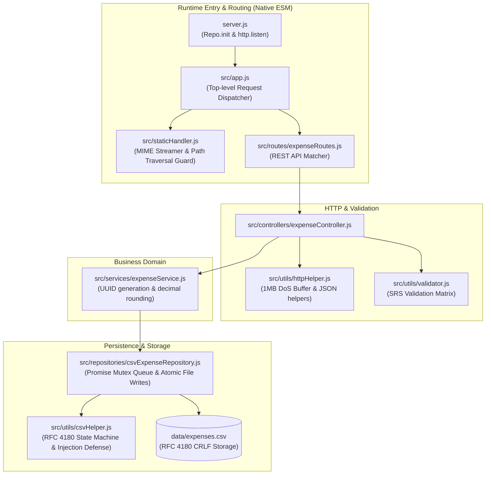

# Backend Technical Design Document
## Smart Expense Tracker

**Client:** ABC & Co Inc  
**Vendor:** XYZ Software Inc  
**Author:** Senior Backend Developer, XYZ Software Inc  
**Target Audience:** Frontend Developer, Full-Stack Developer, Software Architect, Product Owner, QA Lead  
**Governing Documents:**
- `smart_expense_tracker_software_architecture.md` (Software Architecture Document v2.0)
- `smart_expense_tracker_requirements.md` (Software Requirements Specification v1.0)
- `smart_expense_tracker_specification.md` (Customer Specification)  
**Version:** 2.0 (Native ES Modules & Final Stakeholder Alignment)  
**Status:** Approved for Implementation & Review  

---

## 1. Executive Summary & Stakeholder Decisions

### 1.1 Scope
This document provides the definitive implementation design for the backend tier of the **Smart Expense Tracker**. It operationalizes the architectural requirements established in `smart_expense_tracker_software_architecture.md` into concrete ES Module structures, native Node.js routines, interface schemas, and concurrency controls.

### 1.2 Final Stakeholder Decisions & Constraints
Following formal review with the project stakeholders, the backend design incorporates the following agreed decisions:
1. **Native ES Modules (Architect Directive):**
   - The backend codebase uses native **ES Modules (ESM)** (`import`/`export`) with `"type": "module"` in `package.json`.
   - All internal relative imports specify explicit file extensions (e.g., `import config from './config.js'`).
   - Path resolution uses `import.meta.url` via `node:url` and `node:path`.
2. **Zero External Runtime Dependencies (PO Directive):**
   - Strictly built using Node.js built-in core modules: `node:http`, `node:fs`, `node:fs/promises`, `node:path`, `node:url`, and `node:crypto`.
3. **CSV Line Delimiters (Architect & PO Directive):**
   - Strictly formatted with RFC 4180 standard CRLF (`\r\n`) to guarantee universal spreadsheet compatibility across operating systems.
4. **Whitespace Trimming (PO Directive):**
   - Leading and trailing whitespace is automatically stripped from `customer_name` and custom categories before storage.
5. **Payload Alignment (Frontend Developer Directive):**
   - Custom category submission payload structure: `{ customer_name, amount, category: "Custom", custom_category: "..." }`.
   - Amount data type: Backend returns `amount` as a native JSON number (float rounded to 2 decimal places); the Frontend `state.js` formats it into the display currency string (`$X.XX`).
6. **Data Isolation:**
   - Persistent storage maintained in `data/expenses.csv` with automated directory and header initialization.

---

## 2. Backend Module Architecture & Directory Map

```
smart_expense_tracker/
├── package.json                         # Node.js manifest with "type": "module" (zero dependencies)
├── server.js                            # Application bootstrap & graceful shutdown handler
├── src/
│   ├── app.js                           # Top-level HTTP request dispatcher (Static vs. REST API)
│   ├── config.js                        # System paths, constants, port configurations
│   ├── staticHandler.js                 # Safe static asset streamer with MIME resolution
│   ├── routes/
│   │   └── expenseRoutes.js             # REST API endpoint route matcher (/api/expenses)
│   ├── controllers/
│   │   └── expenseController.js         # HTTP payload parser, validation coordinator, status mapper
│   ├── services/
│   │   └── expenseService.js            # Business logic, UUID assignment, category resolution
│   ├── repositories/
│   │   └── csvExpenseRepository.js     # Mutex queue, atomic file replacement, CSV file I/O
│   └── utils/
│       ├── httpHelper.js                # JSON body stream reader (1MB guard) & JSON response writer
│       ├── csvHelper.js                 # RFC 4180 parser/serializer & CSV formula injection defense
│       └── validator.js                 # Backend schema validator matching SRS Validation Matrix
└── data/
    └── expenses.csv                     # Persistent local CSV storage (auto-generated on startup)
```



---

## 3. Detailed Component & Implementation Blueprints (ESM)

### 3.1 `package.json`
Specifies native ES Modules mode and the start script with zero third-party dependencies:

```json
{
  "name": "smart-expense-tracker",
  "version": "1.0.0",
  "description": "Smart Expense Tracker for ABC & Co Inc",
  "type": "module",
  "main": "server.js",
  "scripts": {
    "start": "node server.js"
  },
  "dependencies": {}
}
```

---

### 3.2 `src/config.js`
Uses `node:url` and `node:path` to compute absolute paths in an ES Module environment:

```javascript
// src/config.js
import path from 'node:path';
import { fileURLToPath } from 'node:url';

const __filename = fileURLToPath(import.meta.url);
const __dirname = path.dirname(__filename);

export const ROOT_DIR = path.resolve(__dirname, '..');
export const PORT = parseInt(process.env.PORT, 10) || 3000;
export const DATA_DIR = path.join(ROOT_DIR, 'data');
export const CSV_FILE_PATH = path.join(DATA_DIR, 'expenses.csv');
export const TMP_CSV_FILE_PATH = path.join(DATA_DIR, 'expenses.csv.tmp');
export const PUBLIC_DIR = path.join(ROOT_DIR, 'public');
export const MAX_PAYLOAD_BYTES = 1024 * 1024; // 1MB DoS safety ceiling
export const CSV_HEADERS = ['id', 'customer_name', 'amount', 'category'];
export const CRLF = '\r\n';

export default {
  ROOT_DIR,
  PORT,
  DATA_DIR,
  CSV_FILE_PATH,
  TMP_CSV_FILE_PATH,
  PUBLIC_DIR,
  MAX_PAYLOAD_BYTES,
  CSV_HEADERS,
  CRLF
};
```

---

### 3.3 `src/utils/httpHelper.js`
Handles chunked HTTP streams and standard JSON responses natively:

```javascript
// src/utils/httpHelper.js
import { MAX_PAYLOAD_BYTES } from '../config.js';

export function parseJsonBody(req, maxBytes = MAX_PAYLOAD_BYTES) {
  return new Promise((resolve, reject) => {
    let raw = '';
    let bytes = 0;

    req.on('data', chunk => {
      bytes += chunk.length;
      if (bytes > maxBytes) {
        req.destroy();
        const err = new Error('Payload Too Large');
        err.statusCode = 413;
        return reject(err);
      }
      raw += chunk;
    });

    req.on('end', () => {
      if (!raw.trim()) return resolve({});
      try {
        resolve(JSON.parse(raw));
      } catch {
        const err = new Error('Invalid JSON format');
        err.statusCode = 400;
        reject(err);
      }
    });

    req.on('error', reject);
  });
}

export function sendJson(res, statusCode, data) {
  const payload = JSON.stringify(data);
  res.writeHead(statusCode, {
    'Content-Type': 'application/json; charset=utf-8',
    'Content-Length': Buffer.byteLength(payload)
  });
  res.end(payload);
}

export function sendError(res, statusCode, message) {
  sendJson(res, statusCode, { error: message });
}
```

---

### 3.4 `src/utils/csvHelper.js`
Pure ES Module implementing RFC 4180 parsing, escaping, and CSV formula injection protection:

```javascript
// src/utils/csvHelper.js
import { CRLF } from '../config.js';

/**
 * Neutralizes CSV formula injection in spreadsheet applications (=, +, -, @)
 */
export function sanitizeFieldForCsv(value) {
  const str = typeof value === 'string' ? value : String(value ?? '');
  if (/^[=+@-]/.test(str)) {
    return `'${str}`;
  }
  return str;
}

/**
 * Escapes an individual field according to RFC 4180 rules
 */
export function escapeCsvField(value) {
  const sanitized = sanitizeFieldForCsv(value);
  if (sanitized.includes('"') || sanitized.includes(',') || sanitized.includes('\n') || sanitized.includes('\r')) {
    return `"${sanitized.replace(/"/g, '""')}"`;
  }
  return sanitized;
}

/**
 * Serializes an array of field values into a CRLF-terminated CSV row
 */
export function serializeRow(fields) {
  return fields.map(escapeCsvField).join(',') + CRLF;
}

/**
 * State-machine RFC 4180 CSV parser supporting quoted strings, commas, quotes, and newlines
 */
export function parseCsv(rawCsvText) {
  const rows = [];
  let currentRow = [];
  let currentField = '';
  let insideQuotes = false;

  for (let i = 0; i < rawCsvText.length; i++) {
    const char = rawCsvText[i];
    const nextChar = rawCsvText[i + 1];

    if (char === '"') {
      if (insideQuotes && nextChar === '"') {
        currentField += '"';
        i++; // skip escaped quote
      } else {
        insideQuotes = !insideQuotes;
      }
    } else if (char === ',' && !insideQuotes) {
      currentRow.push(currentField);
      currentField = '';
    } else if ((char === '\r' || char === '\n') && !insideQuotes) {
      if (char === '\r' && nextChar === '\n') i++; // Handle CRLF
      currentRow.push(currentField);
      currentField = '';
      if (currentRow.length > 0 && currentRow.some(f => f.trim() !== '')) {
        rows.push(currentRow);
      }
      currentRow = [];
    } else {
      currentField += char;
    }
  }

  if (currentField || currentRow.length > 0) {
    currentRow.push(currentField);
    if (currentRow.some(f => f.trim() !== '')) {
      rows.push(currentRow);
    }
  }

  return rows;
}
```

---

### 3.5 `src/utils/validator.js`
Validates incoming request payloads against the SRS Validation Matrix and performs whitespace trimming:

```javascript
// src/utils/validator.js

export function validateExpensePayload(payload) {
  const { customer_name, amount, category, custom_category } = payload || {};

  // Rule 1: Customer Name non-empty after trimming
  if (!customer_name || typeof customer_name !== 'string' || customer_name.trim() === '') {
    return { isValid: false, errorMessage: 'Please enter a valid customer name.' };
  }

  // Rule 2: Amount must be numeric and > 0
  const parsedAmount = Number(amount);
  if (amount === undefined || amount === null || isNaN(parsedAmount) || parsedAmount <= 0) {
    return { isValid: false, errorMessage: 'Please enter an amount greater than zero.' };
  }

  // Rule 3: Category must not be empty or default prompt
  if (!category || typeof category !== 'string' || category.trim() === '' || category === 'default') {
    return { isValid: false, errorMessage: 'Please select a category.' };
  }

  // Rule 4: If category is "Custom", custom_category must be non-empty after trimming
  if (category === 'Custom') {
    if (!custom_category || typeof custom_category !== 'string' || custom_category.trim() === '') {
      return { isValid: false, errorMessage: 'Please enter a custom category name.' };
    }
  }

  return { isValid: true, errorMessage: null };
}
```

---

### 3.6 `src/repositories/csvExpenseRepository.js`
Implements the in-memory Promise Queue (mutex) and atomic file rewrite pattern with CRLF row endings:

```javascript
// src/repositories/csvExpenseRepository.js
import fs from 'node:fs/promises';
import { CSV_FILE_PATH, TMP_CSV_FILE_PATH, DATA_DIR, CSV_HEADERS, CRLF } from '../config.js';
import { parseCsv, serializeRow } from '../utils/csvHelper.js';

class CsvExpenseRepository {
  constructor() {
    this.writeQueue = Promise.resolve();
  }

  enqueueWrite(task) {
    this.writeQueue = this.writeQueue.then(task, task);
    return this.writeQueue;
  }

  async initialize() {
    await fs.mkdir(DATA_DIR, { recursive: true });
    try {
      await fs.access(CSV_FILE_PATH);
    } catch {
      // File does not exist: create with headers and CRLF
      const headerRow = CSV_HEADERS.join(',') + CRLF;
      await fs.writeFile(CSV_FILE_PATH, headerRow, 'utf-8');
    }
  }

  async findAll() {
    try {
      const content = await fs.readFile(CSV_FILE_PATH, 'utf-8');
      const rows = parseCsv(content);
      if (rows.length <= 1) return []; // Header only or empty

      // Skip header row
      return rows.slice(1).map(row => ({
        id: row[0],
        customer_name: row[1],
        amount: parseFloat(row[2]),
        category: row[3]
      }));
    } catch (err) {
      if (err.code === 'ENOENT') {
        await this.initialize();
        return [];
      }
      throw err;
    }
  }

  async appendRecord(expense) {
    return this.enqueueWrite(async () => {
      const rowText = serializeRow([
        expense.id,
        expense.customer_name,
        expense.amount.toFixed(2),
        expense.category
      ]);
      await fs.appendFile(CSV_FILE_PATH, rowText, 'utf-8');
      return expense;
    });
  }

  async deleteById(id) {
    return this.enqueueWrite(async () => {
      const content = await fs.readFile(CSV_FILE_PATH, 'utf-8');
      const rows = parseCsv(content);

      if (rows.length <= 1) {
        const error = new Error('Expense record not found.');
        error.statusCode = 404;
        throw error;
      }

      const header = rows[0];
      const dataRows = rows.slice(1);
      const targetIndex = dataRows.findIndex(r => r[0] === id);

      if (targetIndex === -1) {
        const error = new Error('Expense record not found.');
        error.statusCode = 404;
        throw error;
      }

      // Filter out deleted row
      const remainingRows = [header, ...dataRows.filter(r => r[0] !== id)];
      const updatedCsvContent = remainingRows.map(r => serializeRow(r)).join('');

      // Atomic file write & rename
      await fs.writeFile(TMP_CSV_FILE_PATH, updatedCsvContent, 'utf-8');
      await fs.rename(TMP_CSV_FILE_PATH, CSV_FILE_PATH);

      return { success: true, deletedId: id };
    });
  }
}

export default new CsvExpenseRepository();
```

---

### 3.7 `src/services/expenseService.js`
Coordinates business logic, UUID assignment via `node:crypto`, whitespace trimming, and category resolution:

```javascript
// src/services/expenseService.js
import crypto from 'node:crypto';
import repo from '../repositories/csvExpenseRepository.js';

class ExpenseService {
  async getAllExpenses() {
    return await repo.findAll();
  }

  async createExpense(data) {
    const id = `exp-${Date.now()}-${crypto.randomUUID().substring(0, 8)}`;
    const normalizedAmount = Math.round(Number(data.amount) * 100) / 100;
    
    // Automatic whitespace trimming and category resolution
    const trimmedName = data.customer_name.trim();
    const finalCategory = data.category === 'Custom' 
      ? data.custom_category.trim() 
      : data.category.trim();

    const record = {
      id,
      customer_name: trimmedName,
      amount: normalizedAmount,
      category: finalCategory
    };

    await repo.appendRecord(record);
    return record;
  }

  async deleteExpense(id) {
    return await repo.deleteById(id);
  }
}

export default new ExpenseService();
```

---

### 3.8 `src/controllers/expenseController.js`
Integrates request parsing, validation, service invocation, and HTTP status codes:

```javascript
// src/controllers/expenseController.js
import service from '../services/expenseService.js';
import { parseJsonBody, sendJson, sendError } from '../utils/httpHelper.js';
import { validateExpensePayload } from '../utils/validator.js';

class ExpenseController {
  async getExpenses(req, res) {
    try {
      const expenses = await service.getAllExpenses();
      sendJson(res, 200, expenses);
    } catch {
      sendError(res, 500, 'Internal server error while retrieving expenses.');
    }
  }

  async createExpense(req, res) {
    try {
      const body = await parseJsonBody(req);
      const validation = validateExpensePayload(body);

      if (!validation.isValid) {
        return sendError(res, 400, validation.errorMessage);
      }

      const created = await service.createExpense(body);
      sendJson(res, 201, created);
    } catch (err) {
      if (err.statusCode) {
        return sendError(res, err.statusCode, err.message);
      }
      sendError(res, 500, 'Internal server error while saving expense.');
    }
  }

  async deleteExpense(req, res, id) {
    try {
      if (!id || id.trim() === '') {
        return sendError(res, 400, 'Missing expense identifier.');
      }
      const result = await service.deleteExpense(id);
      sendJson(res, 200, result);
    } catch (err) {
      if (err.statusCode === 404) {
        return sendError(res, 404, err.message);
      }
      sendError(res, 500, 'Internal server error while deleting expense.');
    }
  }
}

export default new ExpenseController();
```

---

### 3.9 `src/staticHandler.js`
Securely streams static files from `public/` with MIME type resolution and directory traversal guards:

```javascript
// src/staticHandler.js
import fs from 'node:fs';
import path from 'node:path';
import { PUBLIC_DIR } from './config.js';
import { sendError } from './utils/httpHelper.js';

const MIME_TYPES = {
  '.html': 'text/html; charset=utf-8',
  '.css': 'text/css; charset=utf-8',
  '.js': 'application/javascript; charset=utf-8',
  '.json': 'application/json; charset=utf-8',
  '.png': 'image/png',
  '.jpg': 'image/jpeg',
  '.ico': 'image/x-icon',
  '.svg': 'image/svg+xml'
};

export async function serveStatic(req, res) {
  if (req.method !== 'GET' && req.method !== 'HEAD') {
    return sendError(res, 405, 'Method Not Allowed');
  }

  const parsedUrl = new URL(req.url, `http://${req.headers.host || 'localhost'}`);
  let pathname = decodeURIComponent(parsedUrl.pathname);
  if (pathname === '/') pathname = '/index.html';

  const safePath = path.normalize(pathname).replace(/^(\.\.[/\\])+/, '');
  const filePath = path.join(PUBLIC_DIR, safePath);

  // Security check: ensure path is strictly within PUBLIC_DIR
  if (!filePath.startsWith(PUBLIC_DIR)) {
    return sendError(res, 403, 'Forbidden');
  }

  try {
    const stats = await fs.promises.stat(filePath);
    if (!stats.isFile()) {
      return sendError(res, 404, 'File Not Found');
    }

    const ext = path.extname(filePath).toLowerCase();
    const contentType = MIME_TYPES[ext] || 'application/octet-stream';

    res.writeHead(200, {
      'Content-Type': contentType,
      'Content-Length': stats.size,
      'Cache-Control': ext === '.html' ? 'no-cache' : 'public, max-age=3600'
    });

    if (req.method === 'HEAD') {
      return res.end();
    }

    fs.createReadStream(filePath).pipe(res);
  } catch (err) {
    if (err.code === 'ENOENT') {
      return sendError(res, 404, 'File Not Found');
    }
    sendError(res, 500, 'Internal Server Error');
  }
}
```

---

### 3.10 `src/routes/expenseRoutes.js` & `src/app.js`
Matches API endpoints and handles top-level dispatch:

```javascript
// src/routes/expenseRoutes.js
import controller from '../controllers/expenseController.js';
import { sendError } from '../utils/httpHelper.js';

export function handleExpenseRoutes(req, res, pathname) {
  if (pathname === '/api/expenses') {
    if (req.method === 'GET') {
      return controller.getExpenses(req, res);
    }
    if (req.method === 'POST') {
      return controller.createExpense(req, res);
    }
    return sendError(res, 405, 'Method Not Allowed');
  }

  const deleteMatch = pathname.match(/^\/api\/expenses\/([^/]+)$/);
  if (deleteMatch) {
    if (req.method === 'DELETE') {
      const id = deleteMatch[1];
      return controller.deleteExpense(req, res, id);
    }
    return sendError(res, 405, 'Method Not Allowed');
  }

  sendError(res, 404, 'API endpoint not found.');
}
```

```javascript
// src/app.js
import { handleExpenseRoutes } from './routes/expenseRoutes.js';
import { serveStatic } from './staticHandler.js';

export default function app(req, res) {
  const parsedUrl = new URL(req.url, `http://${req.headers.host || 'localhost'}`);
  const pathname = parsedUrl.pathname;

  if (pathname.startsWith('/api/expenses')) {
    return handleExpenseRoutes(req, res, pathname);
  }

  return serveStatic(req, res);
}
```

---

### 3.11 `server.js` (Server Lifecycle)
Initializes storage on boot and binds the listener:

```javascript
// server.js
import http from 'node:http';
import app from './src/app.js';
import repo from './src/repositories/csvExpenseRepository.js';
import { PORT } from './src/config.js';

async function bootstrap() {
  try {
    // Auto-create data directory and expenses.csv if missing
    await repo.initialize();
    console.log('[Server] CSV Persistence repository initialized.');

    const server = http.createServer(app);

    server.listen(PORT, () => {
      console.log(`[Server] Smart Expense Tracker running at http://localhost:${PORT}`);
    });

    const shutdown = () => {
      console.log('\n[Server] Gracefully shutting down...');
      server.close(() => {
        console.log('[Server] Closed.');
        process.exit(0);
      });
    };

    process.on('SIGINT', shutdown);
    process.on('SIGTERM', shutdown);
  } catch (err) {
    console.error('[Server] Fatal startup error:', err);
    process.exit(1);
  }
}

bootstrap();
```

---

## 4. Frontend Integration Contract & API Interfaces

### 4.1 Endpoint Reference Table

| Method | Endpoint | Request Payload | Success Status | Success Response | Error Status & Message |
| :--- | :--- | :--- | :--- | :--- | :--- |
| `GET` | `/api/expenses` | *None* | `200 OK` | Array of expense objects | `500`: `"Internal server error..."` |
| `POST` | `/api/expenses` | `{ customer_name, amount, category, custom_category? }` | `201 Created` | Created object with `id` | `400`: Specific validation error message |
| `DELETE` | `/api/expenses/:id` | *None* | `200 OK` | `{ "success": true, "deletedId": "<id>" }` | `404`: `"Expense record not found."` |
| `GET` | `/` | *None* | `200 OK` | `public/index.html` | `404`: `"File Not Found"` |

### 4.2 Error Response Envelope
Every client-facing error follows the uniform JSON schema:
```json
{
  "error": "Please enter a valid customer name."
}
```

---

## 5. Development & Testing Sequence for Full-Stack Developer

1. **Project Initialization:**
   - Write `package.json` with `"type": "module"`.
2. **Configuration & Core Utilities:**
   - Create `src/config.js`, `src/utils/httpHelper.js`, `src/utils/csvHelper.js`, and `src/utils/validator.js`.
3. **Repository Layer:**
   - Create `src/repositories/csvExpenseRepository.js`. Test that `initialize()` creates `data/expenses.csv` with CRLF header.
4. **Service & Controller:**
   - Create `src/services/expenseService.js` and `src/controllers/expenseController.js`.
5. **Static Server & Routing:**
   - Create `src/staticHandler.js`, `src/routes/expenseRoutes.js`, `src/app.js`, and `server.js`.
6. **Frontend Integration Verification:**
   - Place `public/index.html` and verify static serving.
   - Execute CLI curl tests:
     ```bash
     # Test GET
     curl -i http://localhost:3000/api/expenses
     # Test POST (Predefined)
     curl -i -X POST http://localhost:3000/api/expenses -H "Content-Type: application/json" -d '{"customer_name":"Alice","amount":50.25,"category":"Food"}'
     # Test POST (Custom)
     curl -i -X POST http://localhost:3000/api/expenses -H "Content-Type: application/json" -d '{"customer_name":"Bob","amount":100,"category":"Custom","custom_category":"Office Supplies"}'
     # Test DELETE
     curl -i -X DELETE http://localhost:3000/api/expenses/<ID_FROM_PREVIOUS_POST>
     ```

