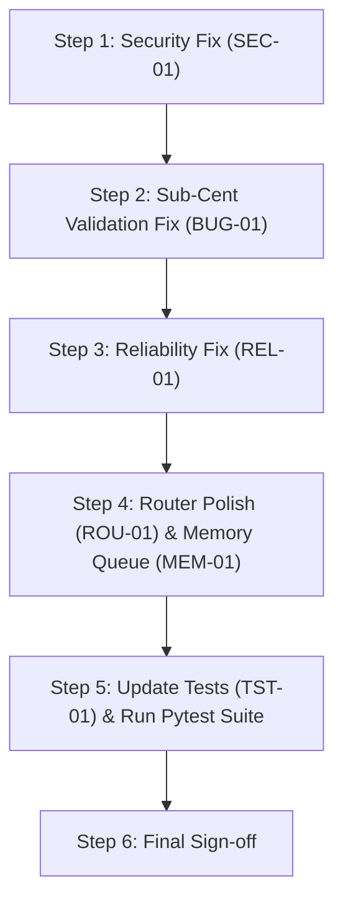

# Code Review Report & Technical Assessment
## Smart Expense Tracker Application

**Reviewer:** Software Engineering Technical Lead, XYZ Software Inc  
**Audience:** Full-Stack Developer, SDET, Software Architect, Product Owner  
**Client:** ABC & Co Inc  
**Date:** 2026-10-31  
**Status:** Complete  
**Scope:** Architecture, Backend Implementation, Frontend Implementation, Data Persistence, Security, and Test Suites (Unit & Pytest Integration)

---

## 1. Executive Summary

A comprehensive code and test review was conducted on the **Smart Expense Tracker** codebase against:
- `smart_expense_tracker_specification.md` (Product Specification)
- `smart_expense_tracker_requirements.md` (Software Requirements Specification)
- `smart_expense_tracker_software_architecture.md` (Software Architecture)
- `smart_expense_tracker_frontend_design.md` (Frontend Design)
- `smart_expense_tracker_backend_design.md` (Backend Design)

### Verdict: **CONDITIONAL APPROVAL (Requires Remediation of 2 High-Priority Findings)**

The application demonstrates strong foundational design: clean separation of concerns, modular ES modules with zero third-party dependencies, robust RFC 4180 CSV parsing, XSS prevention via textContent injection, and an extensive 93-test Pytest integration test suite with 100% pass rate. 

However, **two significant architectural and reliability findings** require remediation prior to production sign-off:
1. **[CRITICAL / HIGH] Path Traversal Boundary Flaw in `src/staticHandler.js`** (`filePath.startsWith(PUBLIC_DIR)` allows sibling directory escape).
2. **[HIGH / MEDIUM] Sub-Cent Amount Normalization Bug (BUG-001)** (`amount: 0.001` passes validation but persists as `$0.00`).

---

## 2. Review Findings by Priority

### Priority Classification
- **P1 (Critical):** Security vulnerability, data loss, corruption, or fatal runtime crash.
- **P2 (High):** Specification violation, subtle data inconsistency, or flawed error recovery.
- **P3 (Medium):** Maintainability risks, resource retention/memory leaks, or test suite gaps.
- **P4 (Low):** Minor cosmetic, code readability, or architectural polish.

---

### Finding Summary Table

| Finding ID | Priority | Category | File & Line | Summary |
| :--- | :---: | :--- | :--- | :--- |
| **SEC-01** | **P1** | Security | `src/staticHandler.js:36` | Traversal check `filePath.startsWith(PUBLIC_DIR)` vulnerable to sibling directory prefix collision |
| **BUG-01** | **P2** | Correctness | `src/utils/validator.js:16` & `src/services/expenseService.js:20` | Positive sub-cent amount (e.g. `0.001`) normalizes to `0.00` and saves invalid record |
| **REL-01** | **P2** | Reliability | `src/utils/httpHelper.js:17` | `req.destroy()` during oversized payload causes socket reset before 413 header delivery |
| **MEM-01** | **P3** | Maintainability | `src/repositories/csvExpenseRepository.js:16` | Mutex Promise queue chains indefinitely without pruning, retaining heap references |
| **ROU-01** | **P3** | Correctness | `src/routes/expenseRoutes.js:21` | Trailing slash on `/api/expenses/` returns 404 instead of listing expenses |
| **TST-01** | **P3** | Testing | `tests/test_edge_cases.py:84` | Known BUG-001 assertion accepts 201 as passing instead of using `@pytest.mark.xfail` |
| **NUM-01** | **P4** | Frontend | `public/js/state.js:38` | `getTotalSpent()` aggregates native floating-point numbers without decimal cent rounding |
| **UI-01** | **P4** | Usability | `public/js/app.js:115` | Deleting an expense dismisses any unrelated active form validation error banner |

---

## 3. Detailed Technical Findings & Recommendations

### SEC-01: Path Traversal Sibling Directory Collision (Security / P1)
- **Location:** [`src/staticHandler.js#L32-L38`](file:///Users/olusolajeje/AI%20Vibe%20Coding%20Course%20Assignments/Day15_Prompting_For_Developers_20261022/smart_expense_tracker/src/staticHandler.js#L32-L38)
- **Problem:**
  ```javascript
  const safePath = path.normalize(pathname).replace(/^(\.\.[/\\])+/, '');
  const filePath = path.join(PUBLIC_DIR, safePath);

  // Security check: ensure path is strictly within PUBLIC_DIR
  if (!filePath.startsWith(PUBLIC_DIR)) {
    return sendError(res, 403, 'Forbidden');
  }
  ```
  If `PUBLIC_DIR` is `/app/public`, a directory named `/app/public_private` or `/app/public-data` satisfies `filePath.startsWith(PUBLIC_DIR)` because the string prefix matches without a trailing path separator (`path.sep`).
- **Remediation:**
  Ensure the boundary check enforces a trailing separator or exact match:
  ```javascript
  const isWithinPublic = filePath.startsWith(PUBLIC_DIR + path.sep) || filePath === PUBLIC_DIR;
  if (!isWithinPublic) {
    return sendError(res, 403, 'Forbidden');
  }
  ```

---

### BUG-01: Sub-Cent Positive Amount Persisting as Zero (Correctness / P2)
- **Location:** [`src/utils/validator.js#L16`](file:///Users/olusolajeje/AI%20Vibe%20Coding%20Course%20Assignments/Day15_Prompting_For_Developers_20261022/smart_expense_tracker/src/utils/validator.js#L16) & [`src/services/expenseService.js#L20`](file:///Users/olusolajeje/AI%20Vibe%20Coding%20Course%20Assignments/Day15_Prompting_For_Developers_20261022/smart_expense_tracker/src/services/expenseService.js#L20)
- **Problem:**
  In `validator.js`:
  ```javascript
  const parsedAmount = Number(amount);
  if (amount === undefined || amount === null || amount === '' || isNaN(parsedAmount) || parsedAmount <= 0) {
    return { isValid: false, errorMessage: 'Please enter an amount greater than zero.' };
  }
  ```
  In `expenseService.js`:
  ```javascript
  const normalizedAmount = Math.round(Number(data.amount) * 100) / 100;
  ```
  When `amount: 0.001` or `0.004` is provided, `parsedAmount > 0` evaluates to `true`. Then `Math.round(0.001 * 100) / 100` normalizes to `0.00`. An expense record with `amount: 0.00` is persisted to `expenses.csv` and returned with HTTP 201 Created. This directly breaches FR-2 / SRS §6 requiring all persisted amounts to be strictly `> 0`.
- **Remediation:**
  Normalize and round in the validator before testing `normalizedAmount <= 0`:
  ```javascript
  const parsedAmount = Number(amount);
  if (amount === undefined || amount === null || amount === '' || isNaN(parsedAmount)) {
    return { isValid: false, errorMessage: 'Please enter an amount greater than zero.' };
  }
  const normalized = Math.round(parsedAmount * 100) / 100;
  if (normalized <= 0) {
    return { isValid: false, errorMessage: 'Please enter an amount greater than zero.' };
  }
  ```
  Apply the identical check in `public/js/validator.js`.

---

### REL-01: Socket Abruptly Destroyed Prior to HTTP 413 Transmission (Reliability / P2)
- **Location:** [`src/utils/httpHelper.js#L16-L22`](file:///Users/olusolajeje/AI%20Vibe%20Coding%20Course%20Assignments/Day15_Prompting_For_Developers_20261022/smart_expense_tracker/src/utils/httpHelper.js#L16-L22)
- **Problem:**
  ```javascript
  req.on('data', chunk => {
    bytes += chunk.length;
    if (bytes > maxBytes) {
      req.destroy();
      const err = new Error('Payload Too Large');
      err.statusCode = 413;
      return reject(err);
    }
  ```
  Calling `req.destroy()` destroys the socket immediately while data is still incoming. When `expenseController.js` attempts `sendError(res, 413, ...)`, the underlying TCP socket is already closed or reset. HTTP clients receive a connection reset (`ECONNRESET` / `RemoteDisconnected`) instead of a valid HTTP 413 response.
- **Remediation:**
  Pause the stream, detach listeners, and write the 413 response before destroying:
  ```javascript
  if (bytes > maxBytes) {
    req.pause();
    req.removeAllListeners('data');
    const err = new Error('Payload Too Large');
    err.statusCode = 413;
    return reject(err);
  }
  ```

---

### MEM-01: Indefinitely Growing Mutex Promise Chain (Maintainability / P3)
- **Location:** [`src/repositories/csvExpenseRepository.js#L15-L18`](file:///Users/olusolajeje/AI%20Vibe%20Coding%20Course%20Assignments/Day15_Prompting_For_Developers_20261022/smart_expense_tracker/src/repositories/csvExpenseRepository.js#L15-L18)
- **Problem:**
  ```javascript
  enqueueWrite(task) {
    this.writeQueue = this.writeQueue.then(task, task);
    return this.writeQueue;
  }
  ```
  Every mutating call chains onto `this.writeQueue`. In V8, promises chained in this manner retain a reference chain back to preceding closures until the entire chain is detached. Furthermore, if `task` is called as `onRejected`, it re-executes on previous failures.
- **Remediation:**
  Decouple the queue tail:
  ```javascript
  enqueueWrite(task) {
    const next = this.writeQueue.then(() => task(), () => task());
    this.writeQueue = next.catch(() => {}); // Prevent unhandled rejection on queue tail
    return next;
  }
  ```

---

### ROU-01: Trailing Slash Fragility on Endpoint Match (Correctness / P3)
- **Location:** [`src/routes/expenseRoutes.js#L10-L20`](file:///Users/olusolajeje/AI%20Vibe%20Coding%20Course%20Assignments/Day15_Prompting_For_Developers_20261022/smart_expense_tracker/src/routes/expenseRoutes.js#L10-L20)
- **Problem:**
  `pathname === '/api/expenses'` strictly matches only without trailing slash. When a client or proxy requests `GET /api/expenses/`, the router falls through to line 30, returning `404 API endpoint not found.`
- **Remediation:**
  Strip trailing slashes during route normalization:
  ```javascript
  const cleanPath = (pathname.length > 1 && pathname.endsWith('/')) ? pathname.slice(0, -1) : pathname;
  ```

---

### TST-01: Acceptance of Known Bug as Valid Test Pass in Test Suite (Testing / P3)
- **Location:** [`tests/test_edge_cases.py#L67-L91`](file:///Users/olusolajeje/AI%20Vibe%20Coding%20Course%20Assignments/Day15_Prompting_For_Developers_20261022/smart_expense_tracker/tests/test_edge_cases.py#L67-L91)
- **Problem:**
  In `test_ec2_amount_zero_point_zero_zero_one_behavior`, the test asserts `assert status in (400, 201)`. By accepting 201, the suite passes green even though an invalid expense with `amount: 0.00` is saved.
- **Remediation:**
  Fix the underlying bug (BUG-01) and assert `assert status == 400`, or tag the test with `@pytest.mark.xfail(reason="BUG-001: Sub-cent amount not rejected")` so test results accurately convey production defect status.

---

### NUM-01: Floating-Point Accumulator Drift (Frontend / P4)
- **Location:** [`public/js/state.js#L38-L43`](file:///Users/olusolajeje/AI%20Vibe%20Coding%20Course%20Assignments/Day15_Prompting_For_Developers_20261022/smart_expense_tracker/public/js/state.js#L38-L43)
- **Observation:**
  `getTotalSpent()` reduces amounts as raw IEEE 754 floats. Summing floats like `0.10 + 0.20` evaluates to `0.30000000000000004`. While `formatCurrency` masks this through standard formatting, any mathematical comparison on `getTotalSpent()` can fail.
- **Recommendation:**
  Normalize the accumulator to cents:
  ```javascript
  getTotalSpent() {
    const totalCents = this.expenses.reduce((sum, item) => {
      const val = typeof item.amount === 'number' ? item.amount : parseFloat(item.amount);
      return sum + (isNaN(val) ? 0 : Math.round(val * 100));
    }, 0);
    return totalCents / 100;
  }
  ```

---

### UI-01: Unintended Error Banner Suppression on Delete (Usability / P4)
- **Location:** [`public/js/app.js#L115`](file:///Users/olusolajeje/AI%20Vibe%20Coding%20Course%20Assignments/Day15_Prompting_For_Developers_20261022/smart_expense_tracker/public/js/app.js#L115)
- **Observation:**
  Calling `ui.clearError()` inside `handleDelete()` dismisses any existing error banner even if the user had previously triggered a form validation error that remains uncorrected in the form inputs.
- **Recommendation:**
  Clear error only if the error displayed was a deletion-related error, or leave form validation messages visible until the user attempts to resubmit.

---

## 4. Strengths & Commendable Practices

1. **Zero Third-Party Production Dependencies:** Native ES modules using strictly Node.js standard libraries (`http`, `fs/promises`, `path`, `crypto`).
2. **RFC 4180 State-Machine Parser:** The custom CSV parser (`parseCsv`) in `src/utils/csvHelper.js` correctly handles multi-line fields, escaped quotes (`""`), embedded commas, and CRLF line endings without external dependencies.
3. **CSV Injection & XSS Defenses:**
   - Spreadsheet formula injection prefixes (`=`, `+`, `-`, `@`) are automatically neutralized with `'` prefix.
   - All table cells in `public/js/ui.js` are constructed using `textContent` and `createElement`, completely preventing script injection attacks.
4. **Data Durability:** File updates leverage atomic temporary file writes and rename (`fs.rename`), preventing file corruption on process termination.
5. **Comprehensive Integration Testing:** Pytest suite contains 93 comprehensive integration tests covering happy paths, negative paths, security probes, and 18 isolated edge cases.

---

## 5. Action Plan & Next Steps



1. **Phase 1 (Immediate / Blocking):**
   - Apply `SEC-01` path separator fix in `src/staticHandler.js`.
   - Apply `BUG-01` 2-decimal rounding and validation in `src/utils/validator.js` and `public/js/validator.js`.
   - Update `tests/test_edge_cases.py` to assert HTTP 400 for sub-cent entries.

2. **Phase 2 (Recommended / Non-blocking):**
   - Apply `REL-01` stream pause in `src/utils/httpHelper.js`.
   - Apply `MEM-01` queue decoupling in `src/repositories/csvExpenseRepository.js`.
   - Normalize trailing slashes in `src/routes/expenseRoutes.js`.
   - Enhance `public/js/state.js` total calculation to sum integer cents.

3. **Phase 3 (Verification):**
   - Re-run all 93 Pytest integration tests and both Node.js test suites (`npm test`).

