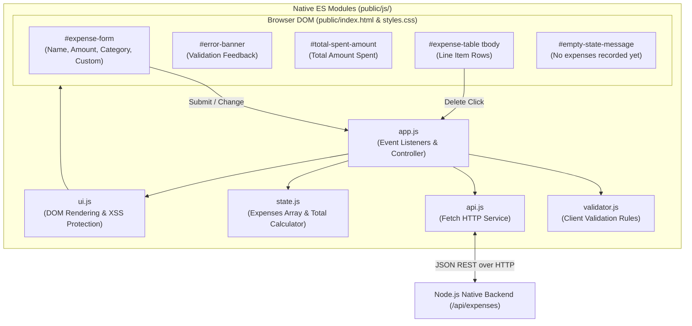
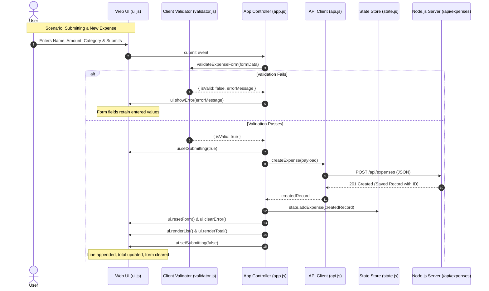
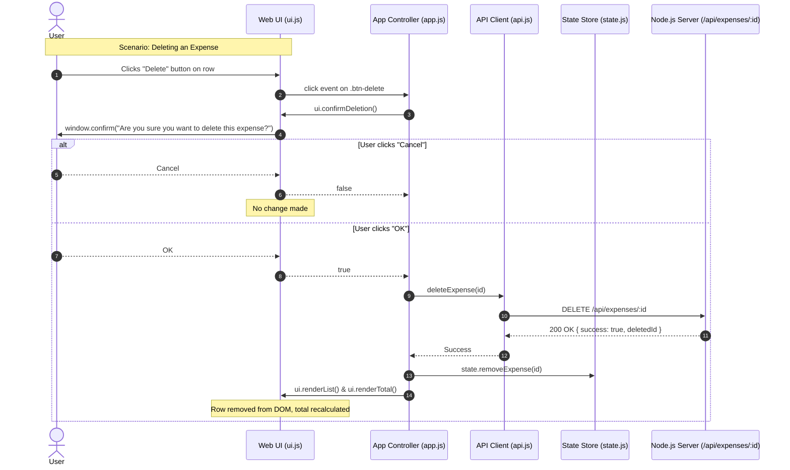

# Frontend Technical Design Document
## Smart Expense Tracker

**Client:** ABC & Co Inc  
**Vendor:** XYZ Software Inc  
**Author:** Senior Front-End (UI) Developer, XYZ Software Inc  
**Target Audience:** Backend Developer, Full-Stack Developer, Software Architect, Product Owner, QA Lead  
**Governing Documents:**
- `smart_expense_tracker_software_architecture.md` (Software Architecture Document v2.0)
- `smart_expense_tracker_backend_design.md` (Backend Technical Design Document v2.0)
- `smart_expense_tracker_requirements.md` (Software Requirements Specification v1.0)
- `smart_expense_tracker_specification.md` (Customer Specification)  
**Version:** 1.0 (Fully Reconciled with Backend Architecture)  
**Status:** Approved for Implementation & Review  

---

## 1. Executive Summary & Design Scope

### 1.1 Purpose
This document provides the definitive technical and UI/UX design for the client-side frontend of the **Smart Expense Tracker**. It operationalizes the requirements from `smart_expense_tracker_requirements.md` and coordinates seamlessly with the native Node.js backend design specified in `smart_expense_tracker_backend_design.md`.

### 1.2 Core Architectural & UX Principles
1. **Zero Build-Step & Native Standards:** Built strictly with Vanilla HTML5, CSS3, and ES6+ JavaScript modules. Runs natively in the browser without bundlers (Webpack, Vite, Rollup) or external CSS/JS libraries.
2. **Synchronized Data Contract:** Fully aligned with the backend's REST API:
   - Submits `{ customer_name, amount, category, custom_category? }`.
   - Consumes JSON numbers for `amount` and formats them client-side into `$X.XX` display currency.
3. **Cross-Site Scripting (XSS) Immunity:** Strict elimination of raw `.innerHTML` string concatenation with user data. All dynamic text is injected via `Node.textContent` and native DOM element factories.
4. **Instant Dynamic UX & Accessibility:** Real-time dynamic recalculation of the "Total Amount Spent" badge, inline custom category toggling, accessible keyboard tab orders, and native confirmation prompts.

---

## 2. UI/UX Wireframe & Layout Hierarchy

The application layout is structured as an uncluttered, single-page interface with a maximum container width of `960px`, centered on screen, responsive to both desktop/laptop viewports ($\ge 1024\text{px}$) and mobile devices.

```
+-----------------------------------------------------------------------+
|                       SMART EXPENSE TRACKER                           |
|                      ABC & Co Inc Financials                          |
+-----------------------------------------------------------------------+
|  +-----------------------------------------------------------------+  |
|  | [!] Error Banner: "Please enter an amount greater than zero."    |  |  (Hidden by default)
|  +-----------------------------------------------------------------+  |
|                                                                       |
|  +-- EXPENSE ENTRY FORM -------------------------------------------+  |
|  | Customer Name:                Amount (USD):                     |  |
|  | [ Enter customer name       ] [ 0.00                          ] |  |
|  |                                                                 |  |
|  | Category:                     Custom Category Name:             |  |
|  | [ Select a category       v ] [ Enter custom category         ] |  |  (Appears when "Custom")
|  |                                                                 |  |
|  | [ Add Expense Button ]                                          |  |
|  +-----------------------------------------------------------------+  |
|                                                                       |
|  +-- SUMMARY METRIC CARD ------------------------------------------+  |
|  | Total Amount Spent: [ $125.50 ]                                 |  |
|  +-----------------------------------------------------------------+  |
|                                                                       |
|  +-- EXPENSE LIST / TABLE -----------------------------------------+  |
|  | Customer Name        | Amount (USD) | Category    | Action      |  |
|  |----------------------+--------------+-------------+-------------|  |
|  | Alice Brown          | $75.20       | Travel      | [ Delete ]  |  |
|  | John Doe             | $50.30       | Food        | [ Delete ]  |  |
|  |                      |              |             |             |  |
|  | (Empty State Placeholder: "No expenses recorded yet.")          |  |
|  +-----------------------------------------------------------------+  |
+-----------------------------------------------------------------------+
```

---

## 3. Frontend Module Decomposition & File Architecture

All frontend source files reside inside the `public/` directory, directly hosted by the backend static file server:

```
public/
├── index.html                   # Semantic HTML5 single-page structure
├── css/
│   └── styles.css               # Design tokens, CSS Grid/Flexbox, responsive styling
└── js/
    ├── app.js                   # Application bootstrap & DOM event orchestrator
    ├── api.js                   # Fetch API service wrapper for /api/expenses
    ├── state.js                 # In-memory store, USD formatter & real-time total calculator
    ├── ui.js                    # DOM rendering engine, error alerts, form reset, dialogs
    └── validator.js             # Client-side input validation matching SRS Validation Matrix
```



---

## 4. Detailed Component & Implementation Blueprints

### 4.1 Semantic Markup (`public/index.html`)

```html
<!DOCTYPE html>
<html lang="en">
<head>
  <meta charset="UTF-8">
  <meta name="viewport" content="width=device-width, initial-scale=1.0">
  <meta name="description" content="Smart Expense Tracker for ABC & Co Inc">
  <title>Smart Expense Tracker</title>
  <link rel="stylesheet" href="css/styles.css">
</head>
<body>
  <div class="app-container">
    <header class="app-header">
      <h1>Smart Expense Tracker</h1>
      <p class="subtitle">Track and manage your expenses effortlessly</p>
    </header>

    <!-- Error Alert Banner -->
    <div id="error-banner" class="error-banner hidden" role="alert" aria-live="assertive">
      <span class="error-icon" aria-hidden="true">&#9888;</span>
      <span id="error-message" class="error-text"></span>
    </div>

    <!-- Data Entry Form Section -->
    <section class="form-section card" aria-labelledby="form-heading">
      <h2 id="form-heading" class="section-title">Add New Expense</h2>
      <form id="expense-form" novalidate>
        <div class="form-grid">
          <!-- Customer Name -->
          <div class="form-group">
            <label for="customer-name">Customer Name <span class="required">*</span></label>
            <input 
              type="text" 
              id="customer-name" 
              name="customer_name" 
              placeholder="Enter customer name" 
              autocomplete="off"
              required>
          </div>

          <!-- Amount in USD -->
          <div class="form-group">
            <label for="amount">Amount in USD ($) <span class="required">*</span></label>
            <input 
              type="number" 
              id="amount" 
              name="amount" 
              placeholder="0.00" 
              step="0.01" 
              min="0.01" 
              required>
          </div>

          <!-- Category Selection -->
          <div class="form-group">
            <label for="category">Category <span class="required">*</span></label>
            <select id="category" name="category" required>
              <option value="default" disabled selected>Select a category</option>
              <option value="Food">Food</option>
              <option value="Travel">Travel</option>
              <option value="Shopping">Shopping</option>
              <option value="Custom">Custom</option>
            </select>
          </div>

          <!-- Custom Category Input (Dynamically Toggled) -->
          <div id="custom-category-group" class="form-group hidden">
            <label for="custom-category">Custom Category Name <span class="required">*</span></label>
            <input 
              type="text" 
              id="custom-category" 
              name="custom_category" 
              placeholder="Enter custom category" 
              autocomplete="off">
          </div>
        </div>

        <div class="form-actions">
          <button type="submit" id="btn-submit" class="btn btn-primary">Add Expense</button>
        </div>
      </form>
    </section>

    <!-- Total Spent Summary Card -->
    <section class="summary-section card" aria-labelledby="total-heading">
      <div class="total-container">
        <span id="total-heading" class="total-label">Total Amount Spent:</span>
        <span id="total-amount" class="total-value" aria-live="polite">$0.00</span>
      </div>
    </section>

    <!-- Expense Records List / Table Section -->
    <section class="list-section card" aria-labelledby="list-heading">
      <h2 id="list-heading" class="section-title">Expense Records</h2>
      
      <!-- Empty State Notice -->
      <div id="empty-state" class="empty-state">
        <p>No expenses recorded yet.</p>
      </div>

      <!-- Expense Table -->
      <div class="table-responsive">
        <table id="expense-table" class="expense-table hidden" aria-describedby="list-heading">
          <thead>
            <tr>
              <th scope="col">Customer Name</th>
              <th scope="col" class="text-right">Amount (USD)</th>
              <th scope="col">Category</th>
              <th scope="col" class="text-center">Action</th>
            </tr>
          </thead>
          <tbody id="expense-table-body">
            <!-- Dynamic Expense Rows Injected Here -->
          </tbody>
        </table>
      </div>
    </section>
  </div>

  <!-- Native ES Module Application Bootstrap -->
  <script type="module" src="js/app.js"></script>
</body>
</html>
```

---

### 4.2 Styling & Responsive Design (`public/css/styles.css`)

```css
/* public/css/styles.css */

/* --- 1. CSS Design Tokens --- */
:root {
  --primary: #2563eb;
  --primary-hover: #1d4ed8;
  --primary-active: #1e40af;
  --danger: #dc2626;
  --danger-hover: #b91c1c;
  --danger-light: #fee2e2;
  --danger-border: #f87171;
  --text-main: #1f2937;
  --text-muted: #4b5563;
  --bg-page: #f3f4f6;
  --bg-card: #ffffff;
  --border-color: #e5e7eb;
  --border-focus: #3b82f6;
  --radius-sm: 4px;
  --radius-md: 8px;
  --shadow-sm: 0 1px 2px 0 rgba(0, 0, 0, 0.05);
  --shadow-md: 0 4px 6px -1px rgba(0, 0, 0, 0.1), 0 2px 4px -1px rgba(0, 0, 0, 0.06);
  --font-sans: -apple-system, BlinkMacSystemFont, "Segoe UI", Roboto, Helvetica, Arial, sans-serif;
}

/* --- 2. Global Resets & Base --- */
*, *::before, *::after {
  box-sizing: border-box;
  margin: 0;
  padding: 0;
}

body {
  font-family: var(--font-sans);
  background-color: var(--bg-page);
  color: var(--text-main);
  line-height: 1.5;
  padding: 2rem 1rem;
}

.app-container {
  max-width: 960px;
  margin: 0 auto;
}

/* --- 3. Header --- */
.app-header {
  text-align: center;
  margin-bottom: 2rem;
}

.app-header h1 {
  font-size: 2rem;
  font-weight: 700;
  color: var(--text-main);
}

.app-header .subtitle {
  color: var(--text-muted);
  font-size: 0.95rem;
  margin-top: 0.25rem;
}

/* --- 4. Cards & Section Headings --- */
.card {
  background: var(--bg-card);
  border-radius: var(--radius-md);
  box-shadow: var(--shadow-sm);
  border: 1px solid var(--border-color);
  padding: 1.5rem;
  margin-bottom: 1.5rem;
}

.section-title {
  font-size: 1.25rem;
  font-weight: 600;
  margin-bottom: 1.25rem;
  color: var(--text-main);
  border-bottom: 1px solid var(--border-color);
  padding-bottom: 0.5rem;
}

/* --- 5. Error Alert Banner --- */
.error-banner {
  display: flex;
  align-items: center;
  gap: 0.75rem;
  background-color: var(--danger-light);
  border: 1px solid var(--danger-border);
  color: var(--danger);
  padding: 0.875rem 1.25rem;
  border-radius: var(--radius-sm);
  margin-bottom: 1.5rem;
  font-weight: 500;
  font-size: 0.95rem;
}

.error-icon {
  font-size: 1.25rem;
  line-height: 1;
}

.hidden {
  display: none !important;
}

/* --- 6. Form Grid & Input Controls --- */
.form-grid {
  display: grid;
  grid-template-columns: repeat(auto-fit, minmax(220px, 1fr));
  gap: 1.25rem;
}

.form-group {
  display: flex;
  flex-direction: column;
}

.form-group label {
  font-size: 0.875rem;
  font-weight: 600;
  margin-bottom: 0.375rem;
  color: var(--text-main);
}

.form-group .required {
  color: var(--danger);
}

.form-group input,
.form-group select {
  font-family: inherit;
  font-size: 0.95rem;
  padding: 0.625rem 0.75rem;
  border: 1px solid var(--border-color);
  border-radius: var(--radius-sm);
  background-color: #fff;
  color: var(--text-main);
  transition: border-color 0.15s ease-in-out, box-shadow 0.15s ease-in-out;
}

.form-group input:focus,
.form-group select:focus {
  outline: none;
  border-color: var(--border-focus);
  box-shadow: 0 0 0 3px rgba(59, 130, 246, 0.25);
}

.form-actions {
  margin-top: 1.5rem;
  display: flex;
  justify-content: flex-end;
}

/* --- 7. Buttons --- */
.btn {
  font-family: inherit;
  font-size: 0.95rem;
  font-weight: 600;
  padding: 0.625rem 1.25rem;
  border-radius: var(--radius-sm);
  border: none;
  cursor: pointer;
  transition: background-color 0.15s ease, transform 0.05s ease;
}

.btn:active {
  transform: translateY(1px);
}

.btn-primary {
  background-color: var(--primary);
  color: #fff;
}

.btn-primary:hover {
  background-color: var(--primary-hover);
}

.btn-delete {
  background-color: transparent;
  color: var(--danger);
  border: 1px solid var(--danger);
  padding: 0.375rem 0.75rem;
  font-size: 0.85rem;
  border-radius: var(--radius-sm);
}

.btn-delete:hover {
  background-color: var(--danger);
  color: #fff;
}

/* --- 8. Total Amount Metric Card --- */
.summary-section {
  padding: 1.25rem 1.5rem;
  background-color: #eff6ff;
  border: 1px solid #bfdbfe;
}

.total-container {
  display: flex;
  justify-content: space-between;
  align-items: center;
}

.total-label {
  font-size: 1.15rem;
  font-weight: 600;
  color: var(--text-main);
}

.total-value {
  font-size: 1.75rem;
  font-weight: 700;
  color: var(--primary);
}

/* --- 9. Expense Table & Empty State --- */
.table-responsive {
  width: 100%;
  overflow-x: auto;
}

.expense-table {
  width: 100%;
  border-collapse: collapse;
  text-align: left;
}

.expense-table th {
  background-color: #f9fafb;
  color: var(--text-muted);
  font-size: 0.825rem;
  font-weight: 700;
  text-transform: uppercase;
  letter-spacing: 0.05em;
  padding: 0.75rem 1rem;
  border-bottom: 2px solid var(--border-color);
}

.expense-table td {
  padding: 0.875rem 1rem;
  border-bottom: 1px solid var(--border-color);
  font-size: 0.95rem;
  color: var(--text-main);
}

.expense-table tbody tr:hover {
  background-color: #f9fafb;
}

.text-right {
  text-align: right;
}

.text-center {
  text-align: center;
}

.empty-state {
  text-align: center;
  padding: 2.5rem 1rem;
  color: var(--text-muted);
  font-size: 1.05rem;
  font-style: italic;
}

/* --- 10. Responsive Breakpoints --- */
@media (max-width: 640px) {
  body {
    padding: 1rem 0.5rem;
  }

  .form-actions {
    justify-content: stretch;
  }

  .form-actions .btn {
    width: 100%;
  }

  .total-container {
    flex-direction: column;
    align-items: flex-start;
    gap: 0.5rem;
  }

  .total-value {
    font-size: 1.5rem;
  }
}
```

---

### 4.3 Client State Container (`public/js/state.js`)

Centralizes application data, calculates the dynamic total spent, and formats currency using native `Intl.NumberFormat`.

```javascript
// public/js/state.js

class StateManager {
  constructor() {
    this.expenses = [];
  }

  /**
   * Sets the full list of expense records (e.g. upon initial page load)
   * @param {Array<{id: string, customer_name: string, amount: number, category: string}>} records 
   */
  setExpenses(records) {
    this.expenses = Array.isArray(records) ? [...records] : [];
  }

  /**
   * Appends a newly created expense record to the state array
   * @param {{id: string, customer_name: string, amount: number, category: string}} record 
   */
  addExpense(record) {
    if (record && record.id) {
      this.expenses.push(record);
    }
  }

  /**
   * Removes an expense record matching the unique identifier
   * @param {string} id 
   */
  removeExpense(id) {
    this.expenses = this.expenses.filter(item => item.id !== id);
  }

  /**
   * Calculates the arithmetic sum of all active, undeleted expense amounts
   * @returns {number}
   */
  getTotalSpent() {
    return this.expenses.reduce((total, item) => {
      const val = typeof item.amount === 'number' ? item.amount : parseFloat(item.amount);
      return total + (isNaN(val) ? 0 : val);
    }, 0);
  }

  /**
   * Formats a numeric amount to standard USD currency format ($X.XX)
   * @param {number} amount 
   * @returns {string} e.g. "$1,250.00" or "$0.00"
   */
  formatCurrency(amount) {
    const num = typeof amount === 'number' ? amount : parseFloat(amount);
    return new Intl.NumberFormat('en-US', {
      style: 'currency',
      currency: 'USD',
      minimumFractionDigits: 2,
      maximumFractionDigits: 2
    }).format(isNaN(num) ? 0 : num);
  }
}

export default new StateManager();
```

---

### 4.4 Client-Side Input Validator (`public/js/validator.js`)

Enforces the exact validation rules and error strings defined in the SRS Validation Matrix before dispatching network requests:

```javascript
// public/js/validator.js

/**
 * Validates the expense form inputs according to the SRS Validation Matrix
 * @param {{customer_name: string, amount: string, category: string, custom_category: string}} formData 
 * @returns {{isValid: boolean, errorMessage: string | null}}
 */
export function validateExpenseForm(formData) {
  const { customer_name, amount, category, custom_category } = formData || {};

  // Rule 1: Customer Name must not be empty or whitespace only
  if (!customer_name || customer_name.trim() === '') {
    return {
      isValid: false,
      errorMessage: 'Please enter a valid customer name.'
    };
  }

  // Rule 2: Amount must be provided, numeric, and > 0
  const parsedAmount = parseFloat(amount);
  if (amount === '' || amount === null || amount === undefined || isNaN(parsedAmount) || parsedAmount <= 0) {
    return {
      isValid: false,
      errorMessage: 'Please enter an amount greater than zero.'
    };
  }

  // Rule 3: Category must be selected (not empty or default prompt)
  if (!category || category.trim() === '' || category === 'default') {
    return {
      isValid: false,
      errorMessage: 'Please select a category.'
    };
  }

  // Rule 4: If Category is "Custom", Custom Category input must not be empty or whitespace only
  if (category === 'Custom') {
    if (!custom_category || custom_category.trim() === '') {
      return {
        isValid: false,
        errorMessage: 'Please enter a custom category name.'
      };
    }
  }

  return {
    isValid: true,
    errorMessage: null
  };
}
```

---

### 4.5 API Service Wrapper (`public/js/api.js`)

Encapsulates all asynchronous HTTP communication with the Node.js backend using standard `fetch`:

```javascript
// public/js/api.js

const API_BASE = '/api/expenses';

class ApiService {
  /**
   * Fetches all expenses from the backend
   * @returns {Promise<Array>} Array of expense objects
   */
  async getExpenses() {
    const response = await fetch(API_BASE, {
      method: 'GET',
      headers: { 'Accept': 'application/json' }
    });

    if (!response.ok) {
      const errorData = await this._parseError(response);
      throw new Error(errorData.error || 'Failed to retrieve expenses from server.');
    }

    return await response.json();
  }

  /**
   * Creates a new expense record on the backend
   * @param {{customer_name: string, amount: number, category: string, custom_category?: string}} payload 
   * @returns {Promise<Object>} Created expense record with id
   */
  async createExpense(payload) {
    const response = await fetch(API_BASE, {
      method: 'POST',
      headers: {
        'Content-Type': 'application/json',
        'Accept': 'application/json'
      },
      body: JSON.stringify(payload)
    });

    if (!response.ok) {
      const errorData = await this._parseError(response);
      throw new Error(errorData.error || 'Failed to save expense.');
    }

    return await response.json();
  }

  /**
   * Deletes an expense record by unique ID
   * @param {string} id 
   * @returns {Promise<Object>}
   */
  async deleteExpense(id) {
    const response = await fetch(`${API_BASE}/${encodeURIComponent(id)}`, {
      method: 'DELETE',
      headers: { 'Accept': 'application/json' }
    });

    if (!response.ok) {
      const errorData = await this._parseError(response);
      throw new Error(errorData.error || 'Failed to delete expense.');
    }

    return await response.json();
  }

  async _parseError(response) {
    try {
      return await response.json();
    } catch {
      return { error: `Server error: ${response.status} ${response.statusText}` };
    }
  }
}

export default new ApiService();
```

---

### 4.6 DOM & UI Rendering Manager (`public/js/ui.js`)

Manages all DOM rendering, visual toggles, XSS-safe row creation, and deletion confirmation dialogs:

```javascript
// public/js/ui.js
import state from './state.js';

class UIManager {
  constructor() {
    // Cache DOM references
    this.form = document.getElementById('expense-form');
    this.customerNameInput = document.getElementById('customer-name');
    this.amountInput = document.getElementById('amount');
    this.categorySelect = document.getElementById('category');
    this.customCategoryGroup = document.getElementById('custom-category-group');
    this.customCategoryInput = document.getElementById('custom-category');
    this.errorBanner = document.getElementById('error-banner');
    this.errorMessage = document.getElementById('error-message');
    this.totalAmountDisplay = document.getElementById('total-amount');
    this.expenseTable = document.getElementById('expense-table');
    this.tableBody = document.getElementById('expense-table-body');
    this.emptyState = document.getElementById('empty-state');
    this.submitBtn = document.getElementById('btn-submit');
  }

  /**
   * Displays the error banner with the specified message
   * @param {string} message 
   */
  showError(message) {
    this.errorMessage.textContent = message;
    this.errorBanner.classList.remove('hidden');
    this.errorBanner.scrollIntoView({ behavior: 'smooth', block: 'nearest' });
  }

  /**
   * Hides the error banner and clears message text
   */
  clearError() {
    this.errorMessage.textContent = '';
    this.errorBanner.classList.add('hidden');
  }

  /**
   * Dynamically toggles visibility of the Custom Category input field
   * @param {string} selectedCategory 
   */
  handleCategoryChange(selectedCategory) {
    if (selectedCategory === 'Custom') {
      this.customCategoryGroup.classList.remove('hidden');
      this.customCategoryInput.focus();
    } else {
      this.customCategoryGroup.classList.add('hidden');
      this.customCategoryInput.value = '';
    }
  }

  /**
   * Resets all form fields to their initial empty states
   */
  resetForm() {
    this.form.reset();
    this.categorySelect.value = 'default';
    this.customCategoryGroup.classList.add('hidden');
    this.customCategoryInput.value = '';
    this.customerNameInput.focus();
  }

  /**
   * Reads raw user values from the form
   * @returns {{customer_name: string, amount: string, category: string, custom_category: string}}
   */
  getFormData() {
    return {
      customer_name: this.customerNameInput.value,
      amount: this.amountInput.value,
      category: this.categorySelect.value,
      custom_category: this.customCategoryInput.value
    };
  }

  /**
   * Updates the on-screen Total Amount Spent badge
   */
  renderTotal() {
    const total = state.getTotalSpent();
    this.totalAmountDisplay.textContent = state.formatCurrency(total);
  }

  /**
   * Renders the complete expense list and updates empty state
   */
  renderList() {
    this.tableBody.innerHTML = ''; // Safe: Clearing existing table rows

    if (state.expenses.length === 0) {
      this.emptyState.classList.remove('hidden');
      this.expenseTable.classList.add('hidden');
    } else {
      this.emptyState.classList.add('hidden');
      this.expenseTable.classList.remove('hidden');

      state.expenses.forEach(item => {
        const row = this.createExpenseRow(item);
        this.tableBody.appendChild(row);
      });
    }

    this.renderTotal();
  }

  /**
   * Creates an individual table row element using safe DOM nodes (XSS Prevention)
   * @param {{id: string, customer_name: string, amount: number, category: string}} item 
   * @returns {HTMLTableRowElement}
   */
  createExpenseRow(item) {
    const tr = document.createElement('tr');
    tr.dataset.id = item.id;

    // 1. Customer Name Cell (Safe text injection)
    const tdName = document.createElement('td');
    tdName.textContent = item.customer_name;
    tr.appendChild(tdName);

    // 2. Amount Cell (Formatted currency, right-aligned)
    const tdAmount = document.createElement('td');
    tdAmount.className = 'text-right';
    tdAmount.textContent = state.formatCurrency(item.amount);
    tr.appendChild(tdAmount);

    // 3. Category Cell (Safe text injection)
    const tdCategory = document.createElement('td');
    tdCategory.textContent = item.category;
    tr.appendChild(tdCategory);

    // 4. Action / Delete Button Cell
    const tdAction = document.createElement('td');
    tdAction.className = 'text-center';

    const deleteBtn = document.createElement('button');
    deleteBtn.className = 'btn btn-delete';
    deleteBtn.textContent = 'Delete';
    deleteBtn.setAttribute('type', 'button');
    deleteBtn.setAttribute('aria-label', `Delete expense for ${item.customer_name}`);
    deleteBtn.dataset.id = item.id;

    tdAction.appendChild(deleteBtn);
    tr.appendChild(tdAction);

    return tr;
  }

  /**
   * Displays the standard browser confirmation prompt
   * @returns {boolean} True if confirmed, false if cancelled
   */
  confirmDeletion() {
    return window.confirm('Are you sure you want to delete this expense?');
  }

  /**
   * Sets the submitting state of the Add Expense button
   * @param {boolean} isSubmitting 
   */
  setSubmitting(isSubmitting) {
    this.submitBtn.disabled = isSubmitting;
    this.submitBtn.textContent = isSubmitting ? 'Adding...' : 'Add Expense';
  }
}

export default new UIManager();
```

---

### 4.7 Application Controller & Bootstrap (`public/js/app.js`)

Orchestrates all event listeners, validation execution, API invocation, state mutations, and UI updates:

```javascript
// public/js/app.js
import api from './api.js';
import state from './state.js';
import ui from './ui.js';
import { validateExpenseForm } from './validator.js';

class AppController {
  constructor() {
    this.init();
  }

  async init() {
    this.bindEvents();
    await this.loadInitialData();
  }

  /**
   * Attaches DOM event listeners
   */
  bindEvents() {
    // Form Submission
    ui.form.addEventListener('submit', (e) => this.handleFormSubmit(e));

    // Category Dropdown Change (Dynamic Custom Category toggle)
    ui.categorySelect.addEventListener('change', (e) => {
      ui.handleCategoryChange(e.target.value);
    });

    // Table Event Delegation for Delete Buttons
    ui.tableBody.addEventListener('click', (e) => {
      const deleteBtn = e.target.closest('.btn-delete');
      if (deleteBtn) {
        const id = deleteBtn.dataset.id;
        this.handleDelete(id);
      }
    });
  }

  /**
   * Loads initial expense records from backend on startup
   */
  async loadInitialData() {
    try {
      const expenses = await api.getExpenses();
      state.setExpenses(expenses);
      ui.renderList();
    } catch (err) {
      ui.showError(err.message || 'Unable to connect to the server.');
    }
  }

  /**
   * Handles expense creation workflow
   * @param {Event} event 
   */
  async handleFormSubmit(event) {
    event.preventDefault();

    const formData = ui.getFormData();
    const validation = validateExpenseForm(formData);

    // If client validation fails: show error and retain existing inputs
    if (!validation.isValid) {
      ui.showError(validation.errorMessage);
      return;
    }

    // Build payload matching backend contract
    const payload = {
      customer_name: formData.customer_name.trim(),
      amount: parseFloat(formData.amount),
      category: formData.category
    };

    if (formData.category === 'Custom') {
      payload.custom_category = formData.custom_category.trim();
    }

    try {
      ui.setSubmitting(true);
      const createdRecord = await api.createExpense(payload);

      // Success workflow
      state.addExpense(createdRecord);
      ui.clearError();
      ui.resetForm();
      ui.renderList();
    } catch (err) {
      // Backend validation or connection error
      ui.showError(err.message);
    } finally {
      ui.setSubmitting(false);
    }
  }

  /**
   * Handles expense deletion workflow
   * @param {string} id 
   */
  async handleDelete(id) {
    if (!id) return;

    // Step 1: Confirmation prompt
    const confirmed = ui.confirmDeletion();
    if (!confirmed) {
      return; // Cancelled by user: no action taken
    }

    try {
      await api.deleteExpense(id);

      // Step 2: Remove from state and re-render UI
      state.removeExpense(id);
      ui.renderList();
      ui.clearError();
    } catch (err) {
      ui.showError(err.message || 'Failed to delete expense record.');
    }
  }
}

// Initialize on DOMContentLoaded
document.addEventListener('DOMContentLoaded', () => {
  new AppController();
});
```

---

## 5. UI State Machine & Interaction Sequences





---

## 6. Frontend & Backend Synchronization Verification

The table below verifies that every aspect of the frontend design is in strict alignment with the backend design in `smart_expense_tracker_backend_design.md`:

| Feature / Interface | Frontend Implementation | Backend Implementation | Status |
| :--- | :--- | :--- | :--- |
| **Asset Directory** | Files located in `public/` (`index.html`, `css/`, `js/`) | `src/staticHandler.js` streams from `public/` | **Synchronized** |
| **GET /api/expenses** | `api.getExpenses()` parses JSON array | `GET /api/expenses` returns JSON array with status `200` | **Synchronized** |
| **POST /api/expenses** | Sends `{ customer_name, amount, category, custom_category? }` | `POST /api/expenses` parses and saves payload, returns `201` | **Synchronized** |
| **DELETE /api/expenses/:id** | Sends `DELETE /api/expenses/${id}` | `DELETE /api/expenses/:id` filters CSV row, returns `200` or `404` | **Synchronized** |
| **Currency Amount** | Handled as `number`, formatted as `$X.XX` via `state.js` | Returned as `number` (2-decimal float) from backend | **Synchronized** |
| **Validation Error Text** | Client validator returns exact SRS strings | Server validator returns identical SRS strings | **Synchronized** |
| **Whitespace Trimming** | Trims input strings on submission | Trims input strings before CSV persistence | **Synchronized** |
| **Custom Category Toggle** | Dynamic CSS class toggle on `#category` change | Supports `category: "Custom"` with `custom_category` | **Synchronized** |
| **Deletion Confirmation** | Triggered via native `window.confirm()` | Backend executes atomic delete only when called | **Synchronized** |
| **Cross-Site Scripting (XSS)** | `textContent` DOM nodes used exclusively | Formula injection sanitized with single quote `'` | **Synchronized** |

---

## 7. Implementation Roadmap for Full-Stack Developer (Frontend Phase)

The Full-Stack Developer should implement the frontend tier in the following exact sequence:

1. **Step 1: HTML Markup (`public/index.html`)**
   - Create semantic layout with form, inputs (exact placeholders and attributes), error banner, summary metric card, table, and empty state notice.
   - Include `<script type="module" src="js/app.js"></script>`.
2. **Step 2: Responsive Stylesheet (`public/css/styles.css`)**
   - Add design tokens, card styles, form grid, error banner, table styles, hover effects, and responsive breakpoints.
3. **Step 3: State Management & Currency Formatting (`public/js/state.js`)**
   - Implement `StateManager` class with `setExpenses`, `addExpense`, `removeExpense`, `getTotalSpent`, and `formatCurrency`.
4. **Step 4: Client-Side Validator (`public/js/validator.js`)**
   - Implement `validateExpenseForm` returning `{ isValid, errorMessage }` for all 4 validation rules.
5. **Step 5: API Service Layer (`public/js/api.js`)**
   - Implement `getExpenses`, `createExpense`, and `deleteExpense` methods using native `fetch`.
6. **Step 6: DOM Rendering & View Manager (`public/js/ui.js`)**
   - Implement XSS-safe row creation with `document.createElement` and `textContent`.
   - Wire up dynamic custom category visibility toggle, form reset, error display, and `window.confirm()`.
7. **Step 7: Application Orchestrator (`public/js/app.js`)**
   - Bind form submission, dropdown changes, and table click delegation for delete buttons.
8. **Step 8: End-to-End Browser Verification**
   - Open browser at `http://localhost:3000`.
   - Test adding valid expenses with predefined categories.
   - Test adding valid expenses with custom categories.
   - Test all 4 validation errors and ensure fields retain entered text.
   - Verify dynamic update of Total Amount Spent.
   - Test deleting an item (verifying Cancel does nothing, OK removes item and recalculates total).
   - Refresh browser page to verify persistent data hydration from backend.

