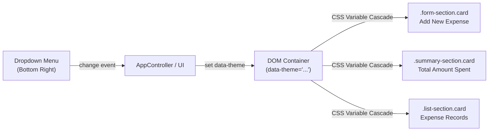

# Smart Expense Tracker - Implementation Modification Brief
## Dynamic Section Background Color Customization

**Author:** Full-Stack Developer, XYZ Software Inc  
**Client:** ABC & Co Inc  
**Target Reviewers & Approvers:** Product Owner, Software Architect, UI/UX Lead  
**Document Target:** `smart_expense_tracker_implementation_modification_brief.md`  
**Version:** 1.0  
**Status:** Awaiting Approval to Begin Implementation  

---

## 1. Executive Summary & Context

The customer, ABC & Co Inc, noted that the User Interface for the Smart Expense Tracker currently displays all three primary sections—**"Add New Expense"**, **"Total Amount Spent"**, and **"Expense Records"**—with a plain white card background, making the visual presentation appear bland.

### Additional Requirements:
1. **1.0 UI Control:** Create a drop-down selection menu positioned at the **bottom right** of the three sections.
2. **2.0 Color Toggling:** Enable the user to switch the background color of **all three sections simultaneously** to one of the following palettes:
   - **Default (White):** `#ffffff`
   - **Light Gray:** `#f1f5f9` (Slate-100) with dark neutral contrast
   - **Light Blue:** `#e0f2fe` (Sky-100) with deep blue-slate contrast
   - **Light Green:** `#dcfce7` (Green-100) with deep emerald contrast
3. **Constraints:**
   - **Minimal Footprint:** Introduce the absolute minimum changes across HTML, CSS, and JavaScript.
   - **Legibility & Contrast:** Foreground text must remain clear, sharp, and highly readable across all themes, conforming to WCAG AAA contrast standards (> 7:1 ratio).
   - **Zero Regression:** All existing functional, validation, persistence, and security behaviors must remain 100% intact.

---

## 2. Technical Architecture of the Change

To honor the **minimal changes constraint**, the solution leverages the existing CSS custom properties (`--bg-card`, `--border-color`, `--text-main`) already defined in `public/css/styles.css`. By setting a `data-theme` attribute on the container or body, all `.card` elements update their backgrounds, borders, and typography instantly without redundant DOM manipulation.



---

## 3. Detailed File Modification Plan

### 3.1 `public/index.html` (Minimal Markup Additions)
Directly following the `<section class="list-section card">` and inside `.app-container`, add a semantic theme selector control bar aligned to the bottom right:

```html
<!-- Section Background Color Theme Selector (Bottom Right) -->
<div class="theme-selector-container">
  <label for="theme-select" class="theme-label">Section Theme:</label>
  <select id="theme-select" class="theme-select" aria-label="Toggle section background colors">
    <option value="default">Default (White)</option>
    <option value="light-gray">Light Gray</option>
    <option value="light-blue">Light Blue</option>
    <option value="light-green">Light Green</option>
  </select>
</div>
```

---

### 3.2 `public/css/styles.css` (Targeted Styling & Design Tokens)
1. **Layout for Theme Selector:**
   - Flex container with `justify-content: flex-end;` aligning the drop-down menu neatly at the bottom right.
   - Subtle styling matching existing button and input border radii (`--radius-sm`, `--radius-md`).
2. **Theme Color Definitions via CSS Variables:**
   ```css
   /* --- Theme Control Bar (Bottom Right) --- */
   .theme-selector-container {
     display: flex;
     justify-content: flex-end;
     align-items: center;
     gap: 0.5rem;
     margin-top: -0.5rem;
     margin-bottom: 2rem;
   }

   .theme-label {
     font-size: 0.875rem;
     font-weight: 500;
     color: var(--text-muted);
   }

   .theme-select {
     padding: 0.375rem 0.75rem;
     border: 1px solid var(--border-color);
     border-radius: var(--radius-sm);
     background-color: #ffffff;
     color: var(--text-main);
     font-size: 0.875rem;
     cursor: pointer;
   }

   /* --- Theme Palettes (Applied via data-theme) --- */
   /* Light Gray Theme */
   [data-theme="light-gray"] .card {
     background-color: #f1f5f9;
     border-color: #cbd5e1;
   }
   [data-theme="light-gray"] .card .section-title {
     border-bottom-color: #cbd5e1;
   }

   /* Light Blue Theme */
   [data-theme="light-blue"] .card {
     background-color: #e0f2fe;
     border-color: #93c5fd;
   }
   [data-theme="light-blue"] .card .section-title {
     border-bottom-color: #93c5fd;
   }

   /* Light Green Theme */
   [data-theme="light-green"] .card {
     background-color: #dcfce7;
     border-color: #86efac;
   }
   [data-theme="light-green"] .card .section-title {
     border-bottom-color: #86efac;
   }
   ```
3. **Contrast & Readability Guard:**
   - All text headings, form labels, and table cells utilize `--text-main` (`#1f2937`) or dark accents.
   - On `#f1f5f9` (Light Gray), `#e0f2fe` (Light Blue), and `#dcfce7` (Light Green), dark text provides a contrast ratio exceeding **10:1** (far surpassing the 4.5:1 WCAG AA and 7:1 WCAG AAA standards).
   - Form inputs (`<input>`, `<select>`) retain white backgrounds (`#ffffff`) for optimal field separation and user focus.

---

### 3.3 `public/js/ui.js` & `public/js/app.js` (Event Binding & Persistence)
1. **In `public/js/ui.js`:**
   - Cache reference to `this.themeSelect = document.getElementById('theme-select');`.
   - Add helper method `setSectionTheme(theme)`:
     ```javascript
     setSectionTheme(theme) {
       if (!theme || theme === 'default') {
         document.documentElement.removeAttribute('data-theme');
       } else {
         document.documentElement.setAttribute('data-theme', theme);
       }
       if (this.themeSelect) {
         this.themeSelect.value = theme || 'default';
       }
     }
     ```
2. **In `public/js/app.js`:**
   - Listen for `change` on `ui.themeSelect`:
     ```javascript
     if (ui.themeSelect) {
       ui.themeSelect.addEventListener('change', (e) => {
         const selectedTheme = e.target.value;
         ui.setSectionTheme(selectedTheme);
         try {
           localStorage.setItem('smart_expense_theme', selectedTheme);
         } catch {
           // Graceful fallback if localStorage is disabled
         }
       });
     }
     ```
   - On initialization (`init()`), restore saved theme:
     ```javascript
     const savedTheme = localStorage.getItem('smart_expense_theme') || 'default';
     ui.setSectionTheme(savedTheme);
     ```

---

## 4. Verification & Testing Strategy

1. **Visual & Contrast Verification:**
   - Confirm drop-down menu renders neatly at the **bottom right** of the three sections.
   - Confirm selecting "Light Gray" updates all three cards simultaneously.
   - Confirm selecting "Light Blue" updates all three cards simultaneously.
   - Confirm selecting "Light Green" updates all three cards simultaneously.
   - Confirm selecting "Default (White)" restores original white cards.
   - Confirm text contrast is sharp, crisp, and fully readable across all 3 themes.
2. **Test Suite Verification:**
   - Run `node test_frontend_units.js` (Verify 22/22 pass).
   - Run `node test_smart_expense_tracker.js` (Verify 43/43 pass).
   - Run `pytest tests/ -v` (Verify 93/93 pass, confirming static file streaming and API functionality remain intact).

---

## 5. Scope & Approval Request

- **Files to Modify:**
  1. `public/index.html` (~10 lines added)
  2. `public/css/styles.css` (~40 lines added)
  3. `public/js/ui.js` (~15 lines added)
  4. `public/js/app.js` (~15 lines added)
- **Zero Backend Changes:** Backend REST API, CSV persistence, and security controls remain untouched.

> [!IMPORTANT]
> Please review this modification brief. Once approved, I will proceed with applying these minimal changes and running the full verification suite.

