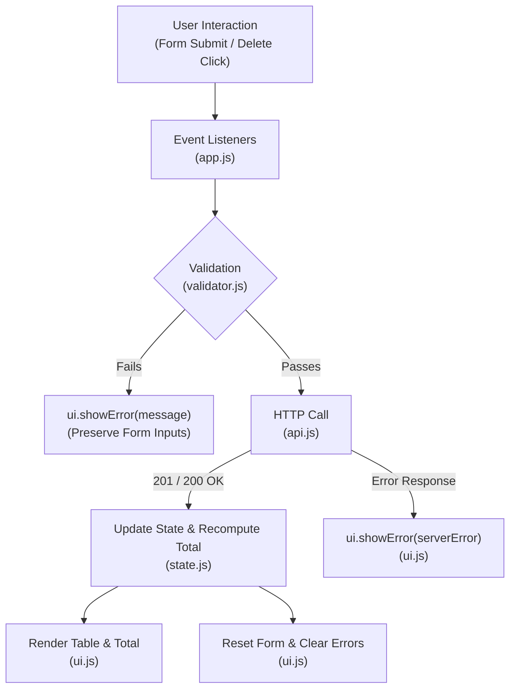
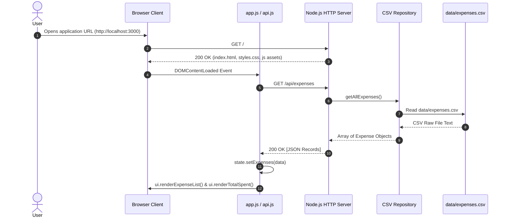
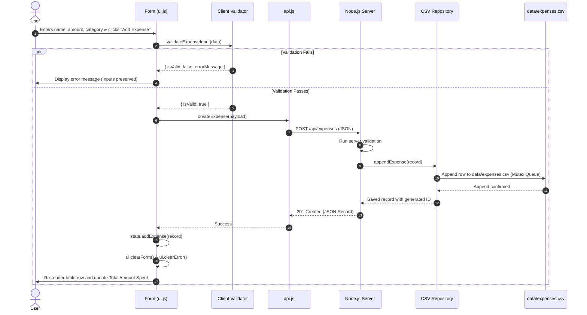
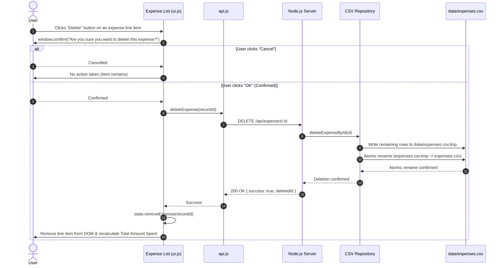

# Software Architecture Document (SAD)
## Smart Expense Tracker

**Client:** ABC & Co Inc  
**Vendor:** XYZ Software Inc  
**Author:** Software Architect, XYZ Software Inc  
**Stakeholders & Reviewers:** Product Owner, Backend Developer, Frontend Developer, QA Lead  
**Governing Specifications:**
- `smart_expense_tracker_specification.md` (Client Specification)
- `smart_expense_tracker_requirements.md` (Software Requirements Specification - SRS v1.0)  
**Version:** 2.0 (Converged Release - Pure Native Node.js & ES Modules)  
**Status:** Approved for Implementation & Review  

---

## 1. Executive Summary & Architectural Decisions

### 1.1 Purpose
This document establishes the authoritative technical and system architecture for the **Smart Expense Tracker**. It serves as the primary technical blueprint for both the Backend Developer and Frontend Developer to build their components independently with zero ambiguity.

### 1.2 Architectural Goals
- **Simplicity & Maintainability:** Modular, clean separation of concerns between presentation, business logic, and file persistence.
- **Autonomy for Developers:** Distinct, well-bounded contracts allowing the Frontend Developer and Backend Developer to implement and unit test their components independently.
- **Data Integrity & Concurrency:** Robust handling of the local CSV file system storage with atomic file writing and sequential write guarantees.
- **Security & Safety:** Strict input sanitization against Cross-Site Scripting (XSS) on the client, path traversal on the static server, and CSV Formula Injection on the server.
- **Zero Build-Step Frontend:** Lightweight, performant Single-Page Application (SPA) leveraging native browser APIs without heavy bundlers or complex framework dependencies.

### 1.3 Product Owner Decisions & Strategic Constraints
Following formal stakeholder alignment with the Product Owner and Software Architect, the following strategic architectural decisions are enforced:
1. **Zero External Dependencies (Pure Native Node.js):**
   - The backend must not use third-party frameworks (such as Express.js) or third-party npm packages.
   - All server operations (HTTP server, routing, request parsing, static asset hosting, CSV parsing/serializing, and persistence) must be implemented strictly using Node.js built-in core modules (`node:http`, `node:fs`, `node:fs/promises`, `node:path`, `node:url`, `node:crypto`).
2. **Native ES Modules (ESM):**
   - The application codebase uses native ES Modules (`import`/`export`) with `"type": "module"` in `package.json`.
3. **Deletion Confirmation Dialog:**
   - Deletion safety is handled via the native browser dialog `window.confirm("Are you sure you want to delete this expense?")` to provide lightweight, consistent, cross-browser behavior.
4. **Data File Isolation:**
   - Persisted data is maintained in `data/expenses.csv` with RFC 4180 standard CRLF (`\r\n`) row endings, keeping data cleanly separated from application source code and public assets.

---

## 2. System Overview & Architectural Pattern

The application is architected as a **2-Tier Client-Server System (Modular Monolith)**:
- **Client Tier (Frontend):** Modern, responsive Vanilla JavaScript Single-Page Application (SPA) executed in the user's browser, responsible for UI rendering, DOM event handling, client-side input validation, and asynchronous REST communication.
- **Server Tier (Backend):** Lightweight, zero-dependency Node.js HTTP server exposing REST API endpoints, enforcing server-side validation, serving static assets, and safely managing local disk read/write operations to `data/expenses.csv`.

```mermaid
flowchart TD
    subgraph ClientTier["Client Tier (Browser Web Application)"]
        UI["UI View / DOM Elements\n(Form, Table, Total, Alerts)"]
        State["State Manager\n(in-memory expenses, total calculation)"]
        ClientVal["Client Validator\n(Validation Matrix Rules)"]
        ApiClient["API Client\n(Native fetch HTTP Service)"]
        
        UI --> ClientVal
        ClientVal --> ApiClient
        ApiClient --> State
        State --> UI
    end

    subgraph ServerTier["Server Tier (Native Node.js - Zero External Dependencies)"]
        HttpServer["Native HTTP Server\n(node:http createServer)"]
        StaticRouter["Static File Server\n(node:path, node:fs mime mapping)"]
        ApiRouter["REST API Router\n(GET, POST, DELETE dispatch)"]
        Controller["Expense Controller\n(Payload parse, HTTP status codes)"]
        ServerVal["Server Validator\n(Validation Matrix & Sanitization)"]
        Service["Expense Service\n(Business Logic & UUID Generation)"]
        Repo["CSV Repository\n(Mutex Promise Queue & Atomic File Writes)"]
        
        HttpServer -->|Static Requests| StaticRouter
        HttpServer -->|/api/* Requests| ApiRouter
        ApiRouter --> Controller
        Controller --> ServerVal
        ServerVal --> Service
        Service --> Repo
    end

    subgraph StorageTier["Storage Tier (Local Filesystem)"]
        CSVFile[("data/expenses.csv\n(RFC 4180 Local Disk File)")]
        Repo <-->|Atomic Write & Rename| CSVFile
    end

    ApiClient <-->|JSON over HTTP / REST (GET, POST, DELETE)| HttpServer
```

---

## 3. Technology Stack & Native Core Modules

| Layer | Component | Selected Technology | Specification & Module |
| :--- | :--- | :--- | :--- |
| **Server Runtime** | Execution Environment | Node.js (LTS v18+) | Native JavaScript runtime with native ES Modules (`"type": "module"`). |
| **HTTP Web Server** | Server & Dispatcher | Built-in `node:http` | Zero external dependencies; native `http.createServer`. |
| **Routing & Static Assets** | Asset Hosting | Built-in `node:path`, `node:fs` | Native path resolution, MIME mapping, path traversal security. |
| **Data Persistence** | File Storage Format | Local CSV (`data/expenses.csv`) | RFC 4180 compliant with CRLF (`\r\n`); persistent across server/browser restarts. |
| **CSV Parsing & Writing** | Parser & Serializer | Native `src/utils/csvHelper.js` | Built-in RFC 4180 parsing, escaping, and formula injection sanitization. |
| **Concurrency Control** | File Mutex Lock | In-Memory Sequential Promise Queue | Native asynchronous chaining ensuring serialized disk writes. |
| **Identifier Generation** | Unique ID Generator | Built-in `node:crypto` | Native `crypto.randomUUID()` or timestamp combination. |
| **Frontend Framework** | Client-Side SPA | Vanilla HTML5, CSS3, ES6+ JS | Zero build/compile steps; fully native in Chrome, Safari, Firefox, Edge. |
| **Client Transport** | Network Requests | Native `window.fetch` API | Standardized async promise-based HTTP client. |

---

## 4. Repository & Project Directory Structure

```
smart_expense_tracker/
├── package.json                                 # Node.js manifest with "type": "module" (zero dependencies)
├── server.js                                    # Entry point: initializes data file & starts HTTP server
├── src/                                         # Backend Source Code (Pure Native Node.js ESM)
│   ├── app.js                                   # Request handler dispatcher (static vs API routing)
│   ├── config.js                                # Configuration constants (PORT, file paths)
│   ├── staticHandler.js                         # Static asset streaming with MIME types & security checks
│   ├── routes/
│   │   └── expenseRoutes.js                     # REST API routing logic for /api/expenses
│   ├── controllers/
│   │   └── expenseController.js                 # Request body parsing, validation, HTTP response output
│   ├── services/
│   │   └── expenseService.js                    # Business logic, ID generation, amount decimal precision
│   ├── repositories/
│   │   └── csvExpenseRepository.js             # Serialized file I/O, atomic file rename, file auto-init
│   └── utils/
│       ├── csvHelper.js                         # RFC 4180 CSV parser, serializer, formula injection defense
│       ├── httpHelper.js                        # JSON request body reader (1MB guard) & standard JSON response helpers
│       └── validator.js                         # Backend input validation matching the Validation Matrix
├── public/                                      # Frontend Static Assets (Served directly to browser)
│   ├── index.html                               # Semantic single-page HTML layout
│   ├── css/
│   │   └── styles.css                           # Modern, responsive CSS styling (Form, Table, Badges)
│   └── js/
│       ├── app.js                               # Application bootstrap & DOM event listeners
│       ├── api.js                               # Fetch API wrapper for /api/expenses
│       ├── state.js                             # Client-side state store & dynamic total spent calculation
│       ├── ui.js                                # DOM rendering, form resets, error alerts, confirm dialog
│       └── validator.js                         # Client-side input validation matching the Validation Matrix
├── data/                                        # Data Isolation Directory
│   └── expenses.csv                             # Persistent CSV data storage (auto-generated on boot)
├── smart_expense_tracker_specification.md        # Customer Functional Specification
├── smart_expense_tracker_requirements.md         # Software Requirements Specification (SRS)
├── smart_expense_tracker_software_architecture.md # Software Architecture Document (this authoritative converged file)
├── smart_expense_tracker_backend_design.md       # Backend Technical Design Document
└── smart_expense_tracker_frontend_design.md      # Frontend Technical Design Document
```

---

## 5. Backend Architecture & Design Details (For Backend Developer)

### 5.1 Request Dispatching & Zero-Dependency Native Architecture
The backend uses Node's native `http.createServer((req, res) => app(req, res))`. The incoming request is dispatched based on the URL path:
1. **API Requests (`/api/expenses*`):** Routed to `src/routes/expenseRoutes.js`.
2. **Static Asset Requests (`/`, `/css/*`, `/js/*`):** Routed to `src/staticHandler.js`.
3. **Fallback:** Any unmatched route returns `404 Not Found`.

```mermaid
flowchart TD
    Req["Incoming HTTP Request (req, res)"] --> Dispatcher{"URL Path Check"}
    Dispatcher -->|Starts with '/api/expenses'| ApiRouter["API Router (expenseRoutes.js)"]
    Dispatcher -->|Static Path ('/', '/css/*', '/js/*')| StaticServer["Static File Handler (staticHandler.js)"]
    Dispatcher -->|Unknown Route| NotFound["404 Not Found Response"]

    ApiRouter --> MethodCheck{"HTTP Method"}
    MethodCheck -->|GET| ControllerGet["Controller.getExpenses"]
    MethodCheck -->|POST| BodyReader["Read Request Body Buffer"] --> ControllerPost["Controller.addExpense"]
    MethodCheck -->|DELETE /:id| ControllerDel["Controller.deleteExpense"]

    StaticServer --> TraversalCheck{"Path Traversal Check"}
    TraversalCheck -->|Safe| StreamFile["Stream File with Correct MIME"]
    TraversalCheck -->|Unsafe| Forbidden["403 / 404 Response"]
```

### 5.2 Native Helper Modules (`src/utils/`)

#### 1. `httpHelper.js` (Request/Response Abstraction)
- **`parseJsonBody(req)`**: Reads incoming stream chunks up to a safe size limit (e.g., 1MB), concatenates the buffer, parses JSON, and rejects if malformed.
  ```javascript
  // Blueprint for Backend Developer:
  export function parseJsonBody(req) {
    return new Promise((resolve, reject) => {
      let body = '';
      req.on('data', chunk => {
        body += chunk;
        if (body.length > 1e6) {
          req.destroy();
          reject(new Error('Payload Too Large'));
        }
      });
      req.on('end', () => {
        if (!body.trim()) return resolve({});
        try {
          resolve(JSON.parse(body));
        } catch (err) {
          reject(new Error('Invalid JSON'));
        }
      });
      req.on('error', reject);
    });
  }
  ```
- **`sendJson(res, statusCode, payload)`**: Sets `Content-Type: application/json; charset=utf-8`, status code, and sends `JSON.stringify(payload)`.

#### 2. `staticHandler.js` (Secure Static File Serving)
- Serves files from `public/` mapping root `/` to `public/index.html`.
- **MIME Type Mapping:**
  - `.html` $\rightarrow$ `text/html; charset=utf-8`
  - `.css` $\rightarrow$ `text/css; charset=utf-8`
  - `.js` $\rightarrow$ `application/javascript; charset=utf-8`
  - `.ico` $\rightarrow$ `image/x-icon`
- **Path Traversal Protection:**
  - Resolves file path using `path.join(PUBLIC_DIR, safePath)`.
  - Verifies `resolvedPath.startsWith(PUBLIC_DIR)` to strictly prevent `../` directory traversal attacks.
  - Returns `404 Not Found` if file does not exist.

#### 3. `csvHelper.js` (RFC 4180 Parsing, Serializing & Sanitizing)
- **RFC 4180 Parser:** Parses CSV lines respecting quoted fields containing commas and double quotes (`""`).
- **RFC 4180 Serializer:** Encloses values in quotes if they contain commas, double quotes, or newlines; escapes internal double quotes as `""`. Uses standard CRLF (`\r\n`).
- **Spreadsheet Formula Injection Defense:** If `customer_name` or `category` starts with `=`, `+`, `-`, or `@`, prepend a single quote `'` before writing to CSV.

### 5.3 Thread-Safe CSV Persistence & Concurrency (`csvExpenseRepository.js`)
To guarantee **NFR-2 (Data Integrity and File Safety)** without a database:
1. **Auto-Initialization on Startup:**
   - Ensures `data/` directory exists (`fs.promises.mkdir(DATA_DIR, { recursive: true })`).
   - Checks if `data/expenses.csv` exists. If not, creates it with header row:
     ```csv
     id,customer_name,amount,category
     ```
2. **In-Memory Sequential Queue (Mutex Lock):**
   - A promise-chain lock ensures that multiple concurrent `POST` or `DELETE` requests execute file operations serially rather than interleaved.
3. **Atomic File Rewriting (For Deletions):**
   - When deleting an expense by `id`, all remaining rows are written to a temporary file (`data/expenses.csv.tmp`).
   - The temporary file is atomically renamed to `data/expenses.csv` using `fs.promises.rename()`. If the server crashes during write, the original `expenses.csv` remains completely intact and uncorrupted.

### 5.4 REST API Interface Contracts

#### 1. `GET /api/expenses`
- **Handler:** `expenseController.getExpenses`
- **Response Status:** `200 OK`
- **Response Body:**
  ```json
  [
    {
      "id": "exp-1730105400000-a1b2",
      "customer_name": "Alice Brown",
      "amount": 75.20,
      "category": "Travel"
    }
  ]
  ```

#### 2. `POST /api/expenses`
- **Handler:** `expenseController.createExpense`
- **Request Headers:** `Content-Type: application/json`
- **Request Body (Predefined Category):**
  ```json
  {
    "customer_name": "John Doe",
    "amount": 45.50,
    "category": "Food"
  }
  ```
- **Request Body (Custom Category):**
  ```json
  {
    "customer_name": "Jane Smith",
    "amount": 120.00,
    "category": "Custom",
    "custom_category": "Software Subscription"
  }
  ```
- **Validation Rules & Error Responses:**
  - If `customer_name` is missing or whitespace-only $\rightarrow$ `400 Bad Request` `{ "error": "Please enter a valid customer name." }`
  - If `amount` is missing, NaN, or $\le 0$ $\rightarrow$ `400 Bad Request` `{ "error": "Please enter an amount greater than zero." }`
  - If `category` is missing or `"default"` $\rightarrow$ `400 Bad Request` `{ "error": "Please select a category." }`
  - If `category === "Custom"` and custom name is whitespace-only $\rightarrow$ `400 Bad Request` `{ "error": "Please enter a custom category name." }`
- **Success Response:** `201 Created`
  ```json
  {
    "id": "exp-1730105450000-c3d4",
    "customer_name": "John Doe",
    "amount": 45.50,
    "category": "Food"
  }
  ```

#### 3. `DELETE /api/expenses/:id`
- **Handler:** `expenseController.deleteExpense`
- **Processing:** Extracts `id` from URL path `/api/expenses/{id}`. Deletes the row from `data/expenses.csv`.
- **Success Response:** `200 OK`
  ```json
  {
    "success": true,
    "deletedId": "exp-1730105450000-c3d4"
  }
  ```
- **Record Not Found Response:** `404 Not Found`
  ```json
  {
    "error": "Expense record not found."
  }
  ```

---

## 6. Frontend Architecture & Design Details (For Frontend Developer)

### 6.1 Modular Unidirectional Architecture
The frontend is implemented in standard modular JavaScript without external frameworks or build tooling.



### 6.2 Module Breakdown (`public/js/`)

#### 1. `state.js` (State Container & Calculations)
- **State Structure:**
  ```javascript
  const state = {
    expenses: [] // Array of { id, customer_name, amount, category }
  };
  ```
- **Methods:**
  - `setExpenses(records)`: Loads all records (used on initial page load).
  - `addExpense(record)`: Appends newly created expense.
  - `removeExpense(id)`: Removes expense matching `id`.
  - `getTotalSpent()`: Returns `state.expenses.reduce((sum, item) => sum + Number(item.amount), 0)`.
  - `formatCurrency(amount)`: Formats number to USD string: `$` prefix, thousands separators, and 2 decimal places (e.g., `$1,250.00`, `$0.00`).

#### 2. `api.js` (Fetch Service Wrapper)
- Encapsulates all backend communications:
  - `async fetchExpenses()`: `GET /api/expenses`
  - `async createExpense(payload)`: `POST /api/expenses`
  - `async deleteExpense(id)`: `DELETE /api/expenses/${id}`
- Error Handling: Checks `response.ok`; if false, reads JSON `{ error }` and throws an Error with the server's message.

#### 3. `validator.js` (Client Validation Matrix)
- Implements synchronous validation before network dispatch:
  - `customer_name`: Trimmed length must be $> 0$. (Message: `"Please enter a valid customer name."`)
  - `amount`: Must be valid float $> 0$. (Message: `"Please enter an amount greater than zero."`)
  - `category`: Must not be empty or `"default"`. (Message: `"Please select a category."`)
  - `custom_category`: If category is `"Custom"`, trimmed custom name must be $> 0$. (Message: `"Please enter a custom category name."`)
- Returns `{ isValid: boolean, errorMessage: string | null }`.

#### 4. `ui.js` (DOM Rendering & Feedback)
- **DOM Element Caching:** Caches inputs, error container, table body, empty state message, and total spent badge.
- **XSS Prevention (NFR-4):**
  - **Rule:** Never use `.innerHTML` with raw user input.
  - Always render using `document.createElement()`, `element.textContent = userValue`, or safe DOM helper functions.
- **Dynamic Custom Category:**
  - Listens to `category` select dropdown change.
  - When `value === "Custom"`: Unhides the custom category input and focuses it.
  - When `value !== "Custom"`: Hides and clears the custom category input.
- **List Rendering:**
  - If `state.expenses.length === 0`: Shows empty state placeholder (`"No expenses recorded yet."`).
  - If `state.expenses.length > 0`: Hides empty state, renders a table/list row for each item with:
    - Customer Name
    - Formatted Amount (`$X.XX`)
    - Category
    - Delete button (`<button class="btn-delete" data-id="${item.id}">Delete</button>`)
- **Total Amount Display:** Updates the total display element with `state.formatCurrency(state.getTotalSpent())`.
- **Error Display:** `showError(message)` reveals the error banner with the exact validation string; `clearError()` hides it.
- **Deletion Confirmation:** Invokes `window.confirm("Are you sure you want to delete this expense?")`.

#### 5. `app.js` (Bootstrap & Controller)
- Listens to `DOMContentLoaded`.
- Calls `api.fetchExpenses()`, updates `state`, and renders initial list and total spent.
- Attaches `submit` listener to the expense form (validates input, calls `api.createExpense`, updates `state`, clears inputs, re-renders).
- Attaches click listener to expense table using event delegation:
  - Detects `.btn-delete` click.
  - Prompts `window.confirm()`.
  - If confirmed: calls `api.deleteExpense(id)`, updates `state`, and re-renders table and total.

---

## 7. Component Interaction Sequence Diagrams

### 7.1 Scenario 1: Page Load & Initial Expense Hydration



### 7.2 Scenario 2: Adding an Expense with Validation



### 7.3 Scenario 3: Expense Deletion with Confirmation



---

## 8. Non-Functional Architecture & Security

### 8.1 Zero External Dependencies Compliance
- The project `package.json` contains no runtime `"dependencies"`.
- All functionality is delivered natively using Node.js standard modules.
- Simplifies deployment, eliminates security vulnerabilities from upstream npm packages, and requires zero build pipelines.

### 8.2 Security & Data Protection
1. **Cross-Site Scripting (XSS) Prevention:**
   - Client rendering strictly uses `textContent` and DOM nodes to neutralize script tags or injected HTML in customer names or categories.
2. **CSV Formula Injection Mitigation:**
   - Any string input starting with `=`, `+`, `-`, or `@` is prepended with a single quote (`'`) before CSV writing to neutralize formula execution in Microsoft Excel and Google Sheets.
3. **Directory Traversal Defense:**
   - `staticHandler.js` verifies that every requested static file path is strictly within the `public/` directory before serving.
4. **Denial of Service (DoS) Buffer Protection:**
   - The native JSON request body parser limits incoming payload size to 1MB, preventing memory exhaustion from oversized requests.

---

## 9. Developer Work Breakdown & Implementation Directives

### 9.1 Backend Developer Tasks
1. **Create `package.json`:** Define standard metadata and `"start": "node server.js"` script without dependencies.
2. **Implement `src/config.js`:** Define `PORT` (`process.env.PORT || 3000`), `DATA_DIR`, `CSV_PATH`, and `PUBLIC_DIR`.
3. **Implement `src/utils/csvHelper.js`:** Write RFC 4180 parsing, serializing, and formula sanitization.
4. **Implement `src/repositories/csvExpenseRepository.js`:**
   - Ensure directory and header creation on startup.
   - Implement sequential write queue.
   - Implement atomic rewrite via temporary file and rename.
5. **Implement `src/utils/httpHelper.js` & `src/utils/validator.js`:** Request body buffering, JSON dispatching, and validation logic.
6. **Implement `src/services/` & `src/controllers/`:** Business logic, ID generation, request routing for `GET`, `POST`, and `DELETE`.
7. **Implement `src/staticHandler.js` & `src/app.js`:** Static asset streaming with MIME types and path traversal guards.
8. **Verify with `curl`:** Test all API endpoints and verify that `data/expenses.csv` updates correctly.

### 9.2 Frontend Developer Tasks
1. **Create `public/index.html`:** Semantic HTML structure containing:
   - Header & title.
   - Expense entry form (Name input, Amount input, Category dropdown with Food, Travel, Shopping, Custom, and hidden Custom Category input).
   - "Add Expense" button.
   - Error message banner container.
   - Total Amount Spent display card/badge.
   - Expense table with columns: Customer Name, Amount (USD), Category, Action.
   - Empty state placeholder message.
2. **Create `public/css/styles.css`:** Clean, responsive design supporting $\ge 1024\text{px}$ viewports and mobile scaling.
3. **Implement `public/js/validator.js`:** Implement the validation matrix returning exact error strings.
4. **Implement `public/js/state.js`:** In-memory store, USD currency formatting, and dynamic total calculation.
5. **Implement `public/js/api.js`:** Native `fetch` wrapper for `/api/expenses`.
6. **Implement `public/js/ui.js` & `public/js/app.js`:**
   - Dynamic Custom Category visibility toggling.
   - Form submission and error rendering (preserving input values on error).
   - Line-by-line table rendering with XSS-safe text nodes.
   - `window.confirm()` deletion trigger, item removal, and instant total recalculation.
